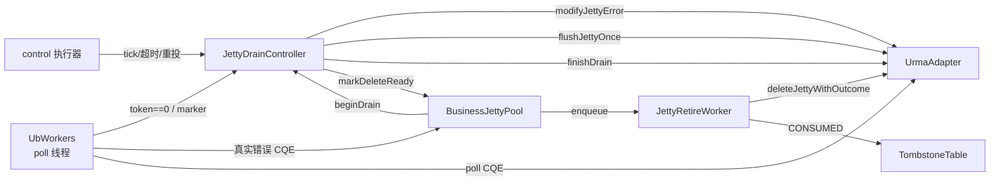
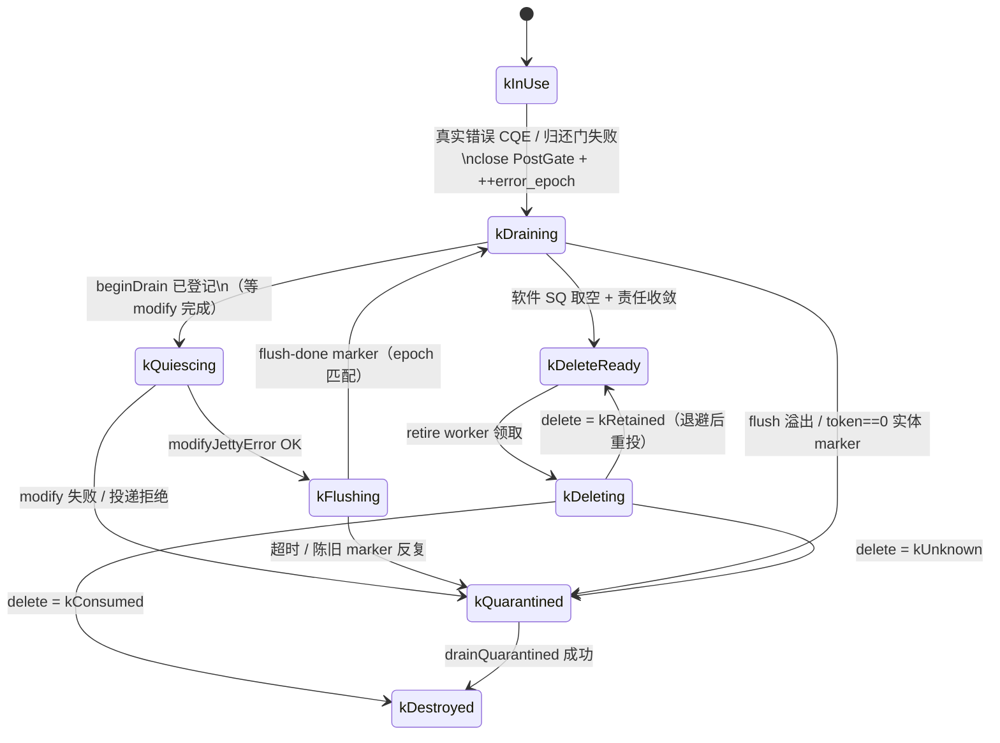

# TENT UB Jetty 异步排空主链详细设计

| 项目 | 内容 |
| --- | --- |
| 状态 | 详细设计（待评审），不含代码改动 |
| 日期 | 2026-11-19 |
| 主干 | `work/merge-ub-rm-jetty` @ `db9d2a40` |
| 闭锁的条款 | 源设计 §1.2 第 13 条（排空）、§1.4「同步 quiesce 池化错误热路径禁止」、总设计 §7.1 / §7.2、外部决策 **B-03** |
| 前置文档 | `docs/analyze/tent-ub-rm-pool-source-design.md`、`docs/analyze/tent-ub-rm-pool-trunk-consolidation-design.md`（附录 E） |
| 范围 | 业务池成员的故障排空与删除状态推进；不含探测 Jetty 的排空（其生命周期独立，见 §6.5） |

---

## 1. 结论摘要

当前池化成员的退役是**一次阻塞调用**：`BusinessJettyPool::retireFaulted()` 在调用者线程上执行 `adapter_->quiesceJetty(...)`，内部持有 JFC 的 poll 锁、`modify ERROR`、自旋等 flush-done、再 `urma_flush_jetty` 取空软件 SQ（`urma_adapter.cpp:1775-1866`）。

这与源设计 §1.4 的裁决直接冲突（同步 quiesce 仅允许 shutdown / Context fatal / 已验证的保守分支）。本设计把这段逻辑**原样拆成五个可独立调度的步骤**，由 poll 线程 + control 执行器驱动，形成：

```
故障 CQE ──> close PostGate ──> modifyJettyError ──> poll 收 flush-done marker
        ──> flushJettyOnce 取空软件 SQ ──> 责任收敛判定 ──> DELETE_READY ──> retire worker
```

**核心不变量**：poll 线程永不阻塞在任何 provider 调用上；delete 线程永不 poll JFC；`modify ERROR` 与 native post 线性化；判据不明一律 quarantine 并停新准入（fail-closed）。

投入约 5 个提交，其中 3 个是纯新增（可独立合入），2 个切换行为（带开关）。

---

## 2. 现状（实测）

### 2.1 现有同步 fence 的完整逻辑

`RealUrmaAdapter::quiesceJetty`（`urma_adapter.cpp:1775`）已经是设计要的那条链，只是写成了阻塞函数：

| 步 | 代码位置 | 行为 | 本设计对应步骤 |
| --- | --- | --- | --- |
| 1 | `:1795` | `std::unique_lock<std::mutex> poll_lock(real_jfc->pollMutex())` | **删除**：改由 poller 自己消费 |
| 2 | `:1800` | 新 ERROR epoch 时 `clearFlushDone(id)` | `modifyJettyError` 内做 |
| 3 | `:1802` | `beginError()` → `urma_modify_jetty(URMA_JETTY_STATE_ERROR)`（`urma_adapter.cpp` 中 `RealJetty::beginError`） | `modifyJettyError` |
| 4 | `:1806-1832` | 自旋 `urma_poll_jfc` 直到 `hasFlushDone(id)`，逐个 `rememberFlushDone`、`releaseSegment(token)` | poller 的 marker 分支 |
| 5 | `:1838-1856` | `urma_flush_jetty` 循环取空软件 SQ，`token == 0` 视为内部错误 | `flushJettyOnce`（有界，可重入） |
| 6 | `:1858-1861` | `clearFlushDone` / `releaseSegmentsForJetty` / `markFlushFenced` | `finishDrain` |

结论：**provider 侧能力与分类都已验证过（fake 适配器下）**，缺的是调度形态，不需要重新发明协议。

### 2.2 为什么池化热路径不能用它

三个具体问题：

1. **持锁跨越等待**：步 1 拿 JFC poll 锁，步 4 自旋最多 `retire_timeout_ms`。期间该 JFC 的**所有其他完成都停止分发**——池化多成员共用一个 JFC，一个成员排空会冻住同 JFC 的其它业务 WR。
2. **调用点位置**：`retireFaulted` 由 `workers` 在**错误 CQE 的分发路径**上调用（`workers.cpp` 的 gate 失败/真实错误分支），等于在 poll 相关路径上做同步 IO，违反源设计 §1.4。
3. **违反设计条款措辞**：§1.4「同步 quiesce | 池化错误热路径禁止」。

### 2.3 代码与注释已经不一致（要先修）

`business_jetty_pool.cpp:499-505`：

```cpp
// Hardware retirement fence (design §7.2 rule 5 / §5.2): modify ERROR,
// consume the flush-done marker, flush the software SQ. ...
const Status fence = adapter_->quiesceJetty(member->jetty, options_.retire_timeout_ms, drained);
```

注释描述的是异步链，实现是同步调用。本设计落地后两者一致；在此之前注释属于误导，评审时应视为缺陷。

### 2.4 可直接复用的件

| 件 | 位置 | 复用方式 |
| --- | --- | --- |
| `RealJetty::beginError()` = `urma_modify_jetty(ERROR)` | `urma_adapter.cpp` | 直接暴露为 `modifyJettyError` |
| `isEntityMarker()`（`WR_SUSPEND_DONE` / `WR_FLUSH_ERR_DONE`） | `urma_adapter.cpp:1221` | 提升为 adapter 分类谓词 |
| `convertCompletion()`：marker 的 `token = 0`，其余为 `user_ctx` | 同上 | marker 归属靠 `local_jetty_id` + epoch |
| `RealJfc::hasFlushDone/rememberFlushDone/clearFlushDone` | `urma_adapter.cpp` | 由 adapter 封装，不让 pool 直接碰 |
| `urma_flush_jetty` 一轮批量（含 `WR_UNHANDLED`） | `urma_adapter.cpp:1838` | 暴露为 `flushJettyOnce` |
| `UbWorkers::dispatchCompletion` 的 `token == 0` 分支 | `workers.cpp:809` | **唯一挂载点**（注释已预留："W4 classification hangs off this single call site"） |
| `entity_event.h`（冻结签名的事件 sink） | `entity_event.h` | marker/AE 走 `EntityEventKind` |
| `TombstoneTable` / `noteTombstoneLocked` / `eraseTombstoneForProvenDestruction` | `tombstone.h`、`business_jetty_pool.cpp:207/227` | 排空起点登记、销毁证据才 erase |
| `JettyRetireWorker`（`DestroyFn`、不 poll JFC） | `jetty_retire_worker.h` | DELETE_READY 的唯一消费者 |

---

## 3. 目标架构

### 3.1 组件与职责



| 组件 | 线程 | 职责 | 禁止 |
| --- | --- | --- | --- |
| `UbWorkers`（poll） | JFC poll 线程 | 收 CQE；真实完成走 `gate::onRealCr`；marker 与无归属事件转交 controller | 不调 provider、不取 pool 锁 |
| `JettyDrainController` | 被调用方线程 + control 执行器 | drain entry 的状态机、modify 投递、marker 归属、软件 flush、DELETE_READY 判定、超时 | 不在 poll 线程上做 provider 调用 |
| `BusinessJettyPool` | 调用者 | 成员状态、预算迁移、tombstone 登记、入退役队列 | 不再调用 `quiesceJetty` |
| `JettyRetireWorker` | 独立删除线程 | reset/delete、三类结果、预算释放 | 不 poll JFC |

### 3.2 三条硬不变量

1. **poll 线程零阻塞**：marker 分支只做一次哈希查表 + 原子递增。任何 provider 调用都投递到 control 执行器。
2. **`modify ERROR` 与 post 线性化**：`RealJetty::beginError()` 已经持有 Jetty 自身 mutex，与 `post()` 尾部临界区互斥，保留该性质（不额外加锁）。
3. **delete 不 poll**：`flushJettyOnce` 只由 control 执行器调用；`JettyRetireWorker` 接口不变。

---

## 4. 接口设计

### 4.1 adapter 新增五个细粒度接口

```cpp
// urma_adapter.h —— 全部为纯新增；quiesceJetty 保留但降级为 legacy 兜底。

// 把 Jetty 推进到 ERROR。幂等：已处于 ERROR 直接 OK。
// 进入新 epoch 时清理该 local_id 的陈旧 flush-done 记录。
// 必须在 post 边界之外调用（内部取 Jetty mutex，与 post 互斥）。
virtual Status modifyJettyError(const JettyPtr& jetty, uint64_t error_epoch) = 0;

// 事件分类：marker / 普通 WR / AE。token==0 不再需要猜测。
enum class EntityMarkerKind : uint8_t { kNone, kFlushDone, kSuspendDone };
virtual EntityMarkerKind classifyEntityMarker(const Completion&) const = 0;

// 取空软件 SQ 的一轮（有界）。返回取回的 WR 完成（token != 0）。
// 返回 OK 且 out.empty() 表示软件 SQ 已空。
// 出现 token == 0 的实体 marker 时返回 InternalError（与 quiesce 的判定一致）。
virtual Status flushJettyOnce(const JettyPtr& jetty,
                              std::vector<Completion>& out) = 0;

// 排空收尾：clearFlushDone / releaseSegmentsForJetty / markFlushFenced。
virtual Status finishDrain(const JettyPtr& jetty) = 0;

// 三类删除结果（§8）。
struct DeleteOutcome {
    enum class Kind : uint8_t { kConsumed, kRetained, kUnknown };
    Kind kind = Kind::kUnknown;
    Status status;
};
virtual DeleteOutcome deleteJettyWithOutcome(JettyPtr& jetty) = 0;
```

**兼容**：`deleteJetty` 保留为 `deleteJettyWithOutcome(...).kind == kConsumed ? OK : status` 的适配包装，避免一次改完所有调用点。

**fake adapter**：五个接口给出确定性实现——`modifyJettyError` 记录调用次数与 epoch；`classifyEntityMarker` 按注入脚本返回；`flushJettyOnce` 从注入队列取；`deleteJettyWithOutcome` 按注入的 `Kind` 返回。`quiesceJetty` 保留原桩。

### 4.2 `JettyDrainController`

```cpp
// jetty_drain_controller.h（新文件）

struct DrainEntry {
    PoolLaneKey lane;                // 排空身份：lane 代次（永不复用），不携带 token
    PoolKey pool_key;
    uint64_t error_epoch = 0;        // 进入 drain 时递增后的值
    uint64_t deadline_ns = 0;        // now + jetty_pool/retire_timeout_ms
    // 责任收敛证据（全部由既有设施推导，不在 PoolMember 上新增计数）
    bool post_gate_closed = false;       // pool 在 beginDrain 时置位
    bool modify_started = false;         // 调 provider 之前认领（poller 判定竞速用）
    bool modify_done = false;            // beginError 返回 ⇒ post 也已退出（同一把 Jetty mutex）
    bool marker_seen = false;            // poll 线程置位，校验 error_epoch
    bool software_sq_empty = false;      // flushJettyOnce 返回空
    bool responsibility_converged = false; // 回调 workers 查该 lane 的存活记录
    size_t software_wr_drained = 0;      // 观测
    bool provider_failure = false;       // 该 entry 的失败是否算 provider 能力失败（§9）
    DrainState state = DrainState::kQuiescing;
};

enum class DrainState : uint8_t {
    kQuiescing,   // 已 close gate，等 modify 完成
    kFlushing,    // modify 完成，等 flush-done marker
    kDraining,    // marker 已见，软件 flush 中
    kDeleteReady, // 全部条件满足，已交 pool
    kQuarantined, // 超时 / 归属不明 / provider 不支持
};
```

> **责任收敛按 lane 代次，不按 token**（落地修正）：池在 `retireFaulted()` 时并不知道
> completion token（token 由 workers 在 publish 时分配），而成员只服务一个 WR、lane
> 代次永不复用。因此 `DrainEntry` 不携带 token，`responsibilityConverged` 只接收 lane，
> workers 用按 generation 计数的 `pooled_lane_refs_` O(1) 回答。

```cpp

class JettyDrainController {
   public:
    JettyDrainController(std::shared_ptr<UrmaAdapter>, TombstoneTable*,
                         ControlExecutor*, DrainCallbacks, DrainOptions);

    // 由 fault 路径调用（poll 线程或归还路径）。只登记 + 投递，不阻塞。
    Status beginDrain(const DrainRequest& request);

    // 由 poll 线程对每个 token==0 的完成调用。只做查表与记账。
    // 返回 true 表示该事件已被本控制器消费（调用方不再走 unknown-token 计数）。
    bool onEntityEvent(const Completion& completion, uint64_t jfc_index);

    // 由 control 执行器驱动：推进 modify / 软件 flush / 超时。
    void tick(uint64_t now_ns);

    // shutdown 时把全部在途 entry 降级为同步 quiesce 兜底。
    void drainSynchronously();

    [[nodiscard]] DrainStats stats() const;
};
```

`DrainCallbacks` 把 pool 侧动作注入，避免 controller 反向依赖 pool：

```cpp
struct DrainCallbacks {
    // 成员已可删除：pool 置 kDeleteReady 并入退役队列
    std::function<void(const PoolLaneKey&, uint64_t error_epoch)> markDeleteReady;
    // 保责任：pool 置 kQuarantined，预算保持
    std::function<void(const PoolLaneKey&, const std::string& reason)> quarantine;
    // 软件 flush 取回的 WR 完成必须走统一结算（恰好一次）
    std::function<void(const Completion&, uint64_t jfc_index)> settleDrainedWr;
    // 责任收敛查询：该 lane 的存活业务记录是否已清零（完成门已一次性认领）
    // （workers 按 lane 代次计数回答，不需在 PoolMember 上新增计数）
    std::function<bool(const PoolLaneKey& lane)> responsibilityConverged;
};
```

### 4.3 workers 的挂载点

`dispatchCompletion` 的 `token == 0` 分支（唯一挂载点）改为：

```cpp
if (completion.token == 0) {
    // 先交给本 context 的 drain controller 认领：marker 属于某个在途排空
    // epoch。controller 随 BusinessSlot 缓存，poll 路径不加锁查表。
    const BusinessSlot* slot = slotFor(local_nic, jfc_index);
    if (slot != nullptr && slot->drain != nullptr &&
        slot->drain->onEntityEvent(completion, jfc_index)) {
        return true;   // 已归属某个 drain，不再是 unknown-token
    }
    // 原逻辑：AE / 无归属 marker → entity_events_ + unknown_token 计数
    ...
}
```

`onEntityEvent` 内部判定（顺序固定）：

```
1. classifyEntityMarker == kNone        → 交给 AE 路径（返回 false）
2. 按 (jfc_index, local_jetty_id) 查 entry
3. 未命中                              → tombstone 命中则记 stale_marker 并返回 true；
                                          否则返回 false（无主 marker，仍按 unknown 计）
4. kFlushDone 且 modify 已请求          → marker_seen = true；返回 true
   （modify 已在飞行中同样合法：进入 ERROR 正是 marker 的成因）
5. kFlushDone 且 modify 尚未请求        → 记 marker_before_error 并转 quarantine（fail-closed）
6. kSuspendDone                        → 记 suspend_done，不推进状态，返回 true
```

### 4.4 pool 侧的改动

```cpp
// business_jetty_pool.cpp —— retireFaulted(..., fence_hardware = true)
// 改前：同步 quiesce → enqueueRetirementLocked
// 改后：
{
    std::lock_guard<std::mutex> lock(mutex_);
    member->state = PoolMemberState::kDraining;   // 不是 kFlushing：还没 modify
    ++member->error_epoch;
    noteTombstoneLocked(member);
    budget_->transition(member->budget, BudgetObjectState::kQuarantined);
}
if (async_drain_) {
    auto status = drain_controller_->beginDrain(
        DrainRequest{lane, pool_key, member->error_epoch, member});
    if (status.ok()) return Status::OK();   // 后续由 callbacks 推进
    // 投递失败（队列满/控制器已停）→ 走 quarantine，不阻塞、不猜测
    return quarantineMember(member, "drain begin rejected");
}
return retireFaultedSync(std::move(member), reason);   // 旧路径，开关关闭时使用
```

`markDeleteReady` 回调（control 执行器线程）只做两件事：置 `kDeleteReady`、`enqueueRetirementLocked`。native delete 仍在 `JettyRetireWorker` 上执行。

---

## 5. 状态机

### 5.1 状态图



> 与现有实现的差异：现在 `retireFaulted` 直接进 `kFlushing` 再同步 fence；新设计引入 `kDraining`（已 close gate、未 modify）作为独立可观测阶段，`kFlushing` 专指"等 marker"。

### 5.2 状态推进表

| # | 触发 | 线程 | 动作 | 下一态 |
| --- | --- | --- | --- | --- |
| 1 | 真实错误 CQE / gate 失败且需硬件 fence | poll / 归还线程 | `closePostGate`、`++error_epoch`、`noteTombstoneLocked`、预算转 kQuarantined、`beginDrain` 入队 | `kDraining` |
| 2 | control 取到 drain 任务 | control | `clearFlushDone`（新 epoch）+ `modifyJettyError` | `kQuiescing → kFlushing` |
| 3 | poll 收到 `kFlushDone` | poll | `marker_seen=true`（校验 epoch） | `kFlushing → kDraining` |
| 4 | control tick 见 `marker_seen` | control | 循环 `flushJettyOnce` 直到空；取回的 WR 交 `settleDrainedWr` | `kDraining` |
| 5 | 责任收敛判定全真 | control | `finishDrain` + `markDeleteReady` | `kDeleteReady` |
| 6 | 超时（`retire_timeout_ms`） | control | 保留 JFC/Context owner、预算不减、`quarantine` | `kQuarantined` |
| 7 | retire worker 删成功 | delete | `eraseTombstoneForProvenDestruction` + 预算释放 | `kDestroyed` |
| 8 | 删失败按三类 | delete | 见 §8 | 见 §8 |

### 5.3 DELETE_READY 的充分条件（逐条，缺一不可）

对应总设计 §7.1 第 7 步：

```cpp
bool readyForDelete(const DrainEntry& e, const PoolMember& m) {
    return e.post_gate_closed           // ① PostGate 已关（pool 在 beginDrain 时做）
        && e.modify_done                // ② modify ERROR 返回 ⇒ post 已退出（同一把 Jetty mutex）
        && e.marker_seen                // ③ 当前 ERROR epoch 的 flush-done 已记录
        && e.software_sq_empty          // ④ 软件 SQ 已取空
        && e.responsibility_converged   // ⑤ 该 lane 的完成门已认领完毕（活记录计数为 0）
        && m.state == PoolMemberState::kDraining;  // ⑥ 成员处于排空中
}
```

**关于字段来源**：现有 `PoolMember` 只有 `{lane, pool_key, jetty, jfc_index, budget,
state, error_epoch, tombstone_recorded, retire_reason}`，没有 post/handler 计数。
本设计**不往 `PoolMember` 上加责任计数**，而是：

| 条件 | 证据来源 | 新增物 |
| --- | --- | --- |
| ① PostGate | pool 在 `beginDrain` 时置位并发给 controller | `DrainEntry::post_gate_closed` |
| ② 无 post 在飞 | adapter 的 Jetty mutex 保证：`modifyJettyError` 返回即代表 post 已退出（`beginError` 与 `post` 取同一把锁） | 由 `DrainEntry::modify_done` 蕴含，无需独立计数 |
| ⑤ handler/结算 | `DrainCallbacks::responsibilityConverged(lane)` → workers 用既有 `CompletionRecord`/`gate` 回答，按 lane 代次的活记录计数 | 一个回调 + `pooled_lane_refs_` 计数，无新状态机 |
| ⑥ 成员状态 | pool 侧既有 `state` | 无 |

写进头文件注释的**反例清单**（这些都是"看起来可以删但不行"）：
- 只看到 marker 就删 → 软件 SQ 里可能还有 `WR_UNHANDLED`。
- 软件 flush 返回 0 就删 → marker 可能还没到（顺序由 provider 决定，不保证）。
- `timeout` 到点就删 → 超时是责任 Unknown，不是屏障。
- `post` 返回错误就删 → 接受范围可能 Unknown。

---

## 6. 事件分类与归属

### 6.1 扩展到总设计 §7.1 的表

| 输入 | `classifyEntityMarker` | 归属依据 | 动作 | 结算 |
| --- | --- | --- | --- | --- |
| SUCCESS / 首次真实 WR 错误 | `kNone`，token≠0 | token → record | `gate::onRealCr` | 恰好一次 |
| `URMA_CR_WR_FLUSH_ERR` | `kNone`（token≠0） | token | 真实 WR 错误，正常结算 | 恰好一次 |
| `URMA_CR_WR_FLUSH_ERR_DONE` | `kFlushDone` | `(jfc, local_id)` + epoch | 推进 drain | 不结算 |
| `URMA_CR_WR_SUSPEND_DONE` | `kSuspendDone` | 同上 | 仅记录 `suspend_done`，不改状态 | 不结算 |
| CR flag 的 `flush_err_done` / `suspend_done` | 按 provider 版本解释 | 同上 | **不得仅凭名称丢 token**：带 token 者按 WR 结算 | 恰好一次 |
| `urma_flush_jetty` 返回 `WR_UNHANDLED` | `kNone`（token≠0） | token | 经 `settleDrainedWr` 统一分发，**不算业务成功** | 恰好一次 |
| AE（异步事件） | `kNone` | native 实体 registry | 按实体定故障域 + 完成 API 要求的 ACK；不当业务 token | 不结算 |
| `token == 0` 且无 entry 命中 | `kNone`/marker | 无 | 原 unknown-token 路径（`entity_events_`） | 不结算 |

### 6.2 重复与迟到

- **重复 marker**：`marker_seen` 已为真 → 只递增 `dup_marker`，不改变状态（`rememberFlushDone` 幂等）。
- **陈旧 marker**（native id 已被新成员复用）：entry 查不到或 epoch 不匹配 → 丢弃并计 `stale_marker`。**不得**因陈旧 marker 推进新 entry。
- **marker 与 modify 竞速**：`modify_started` 在 `modifyJettyError()` 调用**之前**、entry 锁内置位。
  - marker 在 modify **已请求、尚未返回**时到达：合法（进入 ERROR 正是 marker 的成因，poller 与 control 线程天然并发），记 `marker_seen` 并推进。
  - marker 在 modify **尚未请求**时到达：`clearFlushDone(id)` 对新 epoch 还没执行，只可能是 provider 提前 flush 或上一 epoch 的残留 → 计 `marker_before_error` 并转 quarantine（fail-closed）。
  - 单靠"是否已收到返回值"判断会把这个窗口误判为异常；这正是 `modify_started` 存在的原因。
- **marker 晚于超时**：entry 已 quarantine，marker 落到无主路径，仅计数。

### 6.3 软件 flush 取回的 WR 如何结算

这是本设计最容易做错的地方。`urma_flush_jetty` 取回的是**曾被接受、但业务完成没等到**的 WR，它们必须走同一个结算入口，且必须**恰好一次**：

```
flushJettyOnce 返回 completions (token != 0)
  → 对每个 completion 调 callbacks.settleDrainedWr(completion, jfc_index)
  → workers 侧实现：按 token 查 record，命中则直接走同一结算门
     gate::HandlerRef + gate::onRealCr（不经 dispatchCompletion，避免
     token==0 分支与 unknown-token 记账）
  → 若 token 已结算过（record 已 dispose）→ 返回 false，由 controller 计
     drained_after_settle；不重复结算，也不计入 unknown_token
```

"恰好一次"的权威仍是 gate 的一次性认领（`cr_claimed` / `finalize_claimed`）：即使
lookup 之后记录被并发 dispose，`onRealCr` 的 claim 也会让第二次结算成为 no-op。

约束：`settleDrainedWr` **不得**在 poll 线程执行（control 执行器线程）。

### 6.4 AE 的处置

AE 仍走 `entity_event.h` 的既有路径，本设计只补一条：**若 AE 归属的实体正处于 drain**，则把 entry 标记为 `fault_scope` 命中，并在 DELETE_READY 判定前要求 AE 已 ACK。ACK 责任由 adapter 承担（新增 `Status acknowledgeEvent(...)` 或在 adapter 内部完成），不进 controller。

### 6.5 探测 Jetty

探测 Jetty 的排空**不并入本控制器**：它每端口一个、生命周期与 Context 对齐、不参与业务池预算。shutdown 与探测重建仍走 `quiesceJetty`（属于设计允许的 "shutdown / Context fatal" 分支），但需要在代码里注明这是**例外**，避免被后来者当成范式。

---

## 7. 并发与锁序

| 约束 | 做法 |
| --- | --- |
| 锁序 `context/pool → endpoint/path → JFC registry` | controller 只用自身 mutex 保护 entry 表；调用 pool 回调时**不持**自身锁 |
| 不持锁等 provider | `modifyJettyError` / `flushJettyOnce` / `finishDrain` 全部在 control 线程、entry 锁外执行 |
| poll 线程零阻塞 | `onEntityEvent` 只做 `unordered_map` 查找 + 原子写；无 provider、无 pool 锁 |
| `modify` 与 `post` 线性化 | 依赖 `RealJetty::beginError()` 的 Jetty mutex（`urma_adapter.cpp:830`）；controller 只在 `beginDrain` 之后才投递 modify，`modify_done` 返回即证明 post 已退出 |
| entry 生命周期 | entry 由 controller 以 `shared_ptr` 持有；pool 侧 `PoolMember` 与 entry 通过 `PoolLaneKey` 关联，**entry 不持成员强引用**以防池无法析构（与 RC-04 的弱引用约定保持一致） |

**竞态清单**（每一条都要有单测）：

1. marker 先于 `modify` 完成到达。
2. marker 与 `modify ERROR` 并发（同一 JFC 两个 poller）。
3. 软件 flush 与业务 poll 并发取同一个 JFC。
4. `beginDrain` 与 `beginStop` 竞争（stop 后 begin 必须被拒并转 quarantine）。
5. 同一成员重复 fence（重复 `retireFaulted`）。
6. 超时与 marker 同时到达（先到者胜，后者按重复/陈旧处理）。

---

## 8. 三类删除结果

### 8.1 定义与判定来源

| 结果 | 含义 | 判定来源 | 动作 |
| --- | --- | --- | --- |
| `kConsumed` | provider 已收回句柄（成功，或"句柄已不存在"这类可判定为已销毁的错误） | `reset+delete` 成功；或 adapter 把特定 errno 归类为 consumed | `eraseTombstoneForProvenDestruction` + `budget.releaseAfterProvenDestruction` |
| `kRetained` | provider 明确表示句柄仍有效、可重试（如 busy） | adapter 归类 | 指数退避后重投 `kDeleteReady`；预算与 tombstone 保持 |
| `kUnknown` | 无法判定（超时、部分失败、未知错误） | 兜底 | 转 `kQuarantined`，**不再解引用旧句柄**，保留预算与 tombstone，保留 owner |

### 8.2 删除流程

```cpp
void BusinessJettyPool::destroyRetiredBatch(std::vector<shared_ptr<PoolMember>> batch) {
    for (auto& m : batch) {
        m->state = PoolMemberState::kDeleting;
        if (m->jetty && m->jetty->valid()) {
            // reset 仅在 provider 契约要求时执行（源设计 §1.4）。
            // 现状是「一律 reset 再 delete」（business_jetty_pool.cpp:585/750），
            // reset_before_delete 为本设计新增的选项，默认保持现有行为（true）。
            if (options_.reset_before_delete) {
                const Status reset = adapter_->resetJetty(m->jetty);
                if (!reset.ok()) {
                    finishDelete(m, classifyResetFailure(reset));
                    continue;
                }
            }
        }
        auto outcome = adapter_->deleteJettyWithOutcome(m->jetty);
        finishDelete(m, outcome);
    }
}

void BusinessJettyPool::finishDelete(PoolMember& m, DeleteOutcome outcome) {
    switch (outcome.kind) {
        case DeleteOutcome::Kind::kConsumed:
            eraseTombstoneForProvenDestruction(m);   // 预算在此释放
            m.state = PoolMemberState::kDestroyed;
            break;
        case DeleteOutcome::Kind::kRetained:
            requeueWithBackoff(m);                   // 不丢责任
            break;
        case DeleteOutcome::Kind::kUnknown:
            quarantine(m, "delete outcome unknown"); // 保留句柄+预算+tombstone
            break;
    }
}
```

### 8.3 与 tombstone / 预算的关系（不变量）

- tombstone 在**进入 drain 时**登记（`noteTombstoneLocked`），在 `kConsumed` 时 erase。
- 预算释放的唯一条件是 tombstone erase，即"provider 证明销毁"。
- `kRetained` / `kUnknown` 期间该成员的 jetty 槽位**继续计入** `N_jetty(device)`（总设计 §5.3）。

---

## 9. provider 不支持时的 fail-closed

B-03 尚未取得外部确认（源设计 §3）。因此本设计必须自带退路，不能假设 provider 一定发 marker：

1. **能力探测**：drain 首次执行时记录 `marker_seen`；若 `retire_timeout_ms` 内未见到 marker，则：
   - 该 entry → `kQuarantined`；
   - `async_drain_supported = false`（进程级一次性判定）；
   - 之后新故障成员也走 quarantine 而不是无限重试。
2. **准入联动**：连续 `N`（默认 3）次 **provider** drain 失败 → `jetty_pool/force_disable` 等价的运行时刹车生效（停新 Slice 准入、保留受限恢复探测），与总设计 §9.3 的熔断语义一致。落地为 `BusinessJettyPool::admissionBlockedLocked()`：`tryLease` 拒绝新租约、`refillPass` 停补池，并以 `drain_admission_stopped` 暴露。只有"marker 始终不到（超时）"与"provider 契约破裂（flush 吐出实体 marker）"计入失败；AE、句柄消失、责任未收敛等本地异常只 quarantine，不降级。
3. **不允许的退路**：悄悄退回同步 `quiesceJetty` 并继续服务。源设计 §1.4 明文禁止；要么有异步能力，要么 pool gate 失败 / quarantine。

---

## 10. 配置与观测

### 10.1 配置

| 键（`transports/ub/`） | 默认 | 说明 |
| --- | --- | --- |
| `jetty_pool/async_drain` | `true` | 总开关；关掉退回同步 quiesce（仅用于二分定位，不作为生产退路） |
| `jetty_pool/retire_timeout_ms` | 已有 | 单个 entry 从 `beginDrain` 到 DELETE_READY 的总预算 |
| `jetty_pool/drain_flush_batch` | 与 JFC 深度一致 | 一次 `flushJettyOnce` 的上限 |
| `jetty_pool/drain_quarantine_threshold` | `3` | 连续失败触发准入侵权的阈值 |

### 10.2 指标（总设计 §12.1 要求带 generation 与原因）

```text
drain_begin / drain_begin_failed / drain_delete_ready / drain_timeout / drain_quarantined
modify_error_ok / modify_error_fail
marker_flush_done / marker_suspend_done / marker_dup / marker_stale / marker_before_error
entity_event_on_drain
software_flush_calls / software_flush_wrs / software_flush_unhandled
drained_after_settle / delete_consumed / delete_retained / delete_unknown
drain_pending / drain_oldest_age_ms / async_drain_supported / drain_admission_stopped
```

每 WR 热路径不得同步打印；周期摘要沿用现有 log-every-N 汇总行。

---

## 11. 测试计划

### 11.1 单测（fake adapter + 假时钟）

| 域 | 用例 |
| --- | --- |
| 正常链 | marker→flush→DELETE_READY 全序；每步断言成员状态 |
| 顺序异常 | marker 早于 modify；marker 重复；marker 缺失；marker epoch 不匹配 |
| 软件 flush | 一次取空 / 多次取空 / 返回 `WR_UNHANDLED` / 返回 token==0 实体 marker（应 InternalError → quarantine） |
| modify | 幂等（重复调用只发一次 native）；失败 → quarantine |
| 超时 | 无 marker 超时 → quarantine；超时后迟到 marker 只计数 |
| 结算 | flush 取回的 WR 走统一结算且恰好一次；已 dispose 的 token 不重复结算 |
| 三类删除 | consumed/retained/unknown 各自的后续状态、预算与 tombstone |
| poll 不阻塞 | 单线程 poll：drain 进行中另一个 WR 的完成仍被即时分发 |

### 11.2 并发

- 两个 poller 共用 JFC 时 marker 归属不串。
- `beginDrain` 与 `beginStop` 竞争：stop 后 begin 被拒且成员 quarantine。
- `retireFaulted` 重复调用：第二次为 no-op（不重复 noteTombstone）。

### 11.3 集成

- 4 口 8 路径、单路径故障：只有该路径隔离，其它路径 p99 不因排空而抖动（对照当前同步实现测量）。
- 池满载时触发 drain：`Deficit` 不把 drain 中成员算作可用，补池不超预算。
- shutdown：`drainSynchronously()` 把在途 entry 降级为同步 quiesce，仍保证"未证明责任不释放"。

### 11.4 实机（归入 §10.3 门槛）

`modify ERROR → marker → urma_flush_jetty → delete/clean_jfc` 的真实顺序、并发与 ID 行为，软件单测不能替代。需记录 URMA/UDMA/驱动/profile 版本（B-01/B-04）。

---

## 12. 实施拆分

| # | 提交 | 内容 | 是否改行为 | 可否独立合入 |
| --- | --- | --- | --- | --- |
| 1 | `[TENT][UB] Expose the drain primitives on the URMA adapter` | 五个细粒度接口 + fake 实现 + `deleteJetty` 适配包装 | 否 | 是 |
| 2 | `[TENT][UB] Classify entity markers at the poll dispatch` | `classifyEntityMarker` 接入 `dispatchCompletion`，只计数不推进 | 否（仅观测） | 是 |
| 3 | `[TENT][UB] Add the pooled Jetty drain controller` | `JettyDrainController` + pool 钩子 + `async_drain` 开关（默认 off） | 否（未启用） | 是 |
| 4 | `[TENT][UB] Drive pooled retirement through the drain chain` | 打开开关；`retireFaulted` 不再同步 quiesce；修正 §2.3 的注释 | **是** | 否（依赖 1–3） |
| 5 | `[TENT][UB] Classify delete outcomes and gate the budget release` | `deleteJettyWithOutcome` + 三类处理 + tombstone erase 条件收紧 | **是** | 否（依赖 4） |

每步验收：

1. 编译通过；fake 下 `quiesceJetty` 与五个接口的调用计数一致（等价性断言）。
2. `marker_*` 指标在现有测试中全 0（无回归），`unknown_token` 不增加。
3. 新增单测在开关 off 时全部走旧路径，行为与当前 17/17 一致。
4. `drain_timeout` 为 0；pod 内 `modify_error_ok` 与故障注入次数一致。
5. `delete_unknown` 在正常路径为 0；注入 unknown 时预算不释放且 tombstone 保留。

---

## 13. 风险与回滚

| 风险 | 影响 | 缓解 |
| --- | --- | --- |
| marker 归属错乱（native id 复用） | 误删在飞 Jetty | epoch 校验 + tombstone；不匹配一律丢弃并计数 |
| control 执行器排队延迟 | 排空变慢、成员长时间占预算 | entry 有 deadline；超时即 quarantine；`drain_oldest_age_ms` 告警 |
| flush 取回的 WR 被重复结算 | 计数错误 / 双重归还 | 结算入口一次性认领；`drained_after_settle` 断言为 0 |
| provider 不发 marker（B-03 未确认） | 全部成员进 quarantine | §9 的 fail-closed + 准入侵权 |
| 与 shutdown 竞争 | 未证明责任被释放 | `drainSynchronously()` 兜底；幂等 |
| 打开开关后行为回退 | 生产异常 | `jetty_pool/async_drain=false` 一键回旧路径（仅有开关期间） |

回滚：提交 1–3 纯新增，可单独 revert；提交 4–5 由开关控制；打开开关后若需回滚，先 `async_drain=false` 观察一轮再 revert。

---

## 14. 与设计条款的映射（评审用）

| 源设计条款 | 本设计对应 | 落地后可判 |
| --- | --- | --- |
| §1.2-13「关闭 post 门禁、modify ERROR、持续正常 poll、识别 flush-done，再软件 flush 并结算剩余 WR」 | §5 状态机 + §6 事件表 | 满足 |
| §1.4「同步 quiesce 池化错误热路径禁止」 | §4.4（pool 不再调 quiesce）+ §6.5（仅 shutdown/探测例外） | 满足 |
| §1.4「delete 失败三态」 | §8 | 满足 |
| 总设计 §7.1 第 4–7 步 | §5.2 推进表 1–5 | 满足 |
| 总设计 §7.2 规则 1–5 | §3.1 职责表 + §8.2 | 满足（tombstone/generation 校验沿用现有件） |
| 总设计 §11.4「退役链、排他删除、三类句柄结果、tombstone/事件屏障」 | §5.3 判定 + §8.3 不变量 | 满足（实机证据另计） |
| 外部决策 **B-03** | §9 fail-closed + §11.4 实机 | 代码可先行；真机结论仍需 Owner 证据 |
| 差异登记 **D-05**「主干已分 legacy 同步与 pooled 异步状态机」 | 本设计落地后才成立 | 落地后回写文档 |
