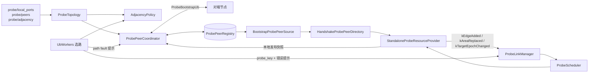
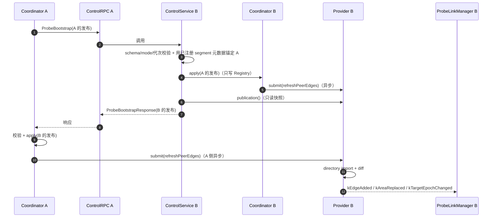

# TENT UB 探测接线与声明式邻接生效详细设计

| 项目 | 内容 |
| --- | --- |
| 状态 | 详细设计（已实施：配置/选路/握手/动态图/观测，UT 见附录 D） |
| 日期 | 2026-11-19 |
| 主干 | `work/merge-ub-rm-jetty` |
| 代码基线 | `51a993be`（`[Bugfix][TENT][UB] Normalize the probe RM transport mode`） |
| 上游设计 | 《TENT UB RM SEND Jetty 池化与链路探测设计（最终版）》§2.2/§4.2/§6/§9；《TENT UB 链路探测详细设计》W1；《TENT UB RM 池化主干收敛详细设计》§E.3-3 |
| 范围 | 物理 UB + CPU DRAM 单边 READ/WRITE；把配置里的本端口、对端口、可达关系（`local_ports` + 新增 `peers` + `adjacency`）变成"选路与探测图的唯一拓扑来源"；补上探测运行期句柄的生产接线 |
| 目的 | 让"配置声明 → 业务选路 → 探测建图 → 故障隔离 → 恢复"成为一条闭环，并且能评审、能测试、能灰度、能回滚 |

本文所有"事实"都给出可复核的源码锚点（附录 A）。标注 **待定** 的条目是需要评审拍板的默认值（§15）。

阅读建议：只看结论看 §0；关心配置怎么写看 §4；关心"声明怎么挡住路/怎么建探测边"看 §5–§6；关心对端信息怎么来、RPC 长什么样看 §7；关心装配/关闭/回滚看 §8–§9；评审拍板看 §15。

---

## 0. 结论摘要

本次要做的只有两件事，但它们必须一起做：

1. **声明式邻接生效**：配置显式给出**本端可用口、对端可用口（含 EID）、以及哪些口到哪些口可达**，这张映射图成为业务选路的第一道门和探测图边集合的唯一来源。不在图里的链路不参与选路；对端没有探测发布的已声明链路允许先跑（`ELIGIBLE_UNVERIFIED`），但不会被"猜"成健康。
2. **探测接线**：新增一次节点级 `ProbeBootstrapUb` 握手，双方交换"本端探测口清单 + 探针 Jetty + 探测区描述符 + 代次 + 门禁位"。这次握手既拉取（周期刷新）也推送（本地探针重建后立即通知对端），产出的发布被装配成现有 `ProbeLinkManager` 已经支持的动态图事件。

交付后：

```text
配置声明（人工意图）
   ├─ 业务选路：只允许声明边（fail-closed，可观测拒绝原因）
   └─ 探测图：只为声明边建 probe 链路（每本端口 1 个 probe Jetty，多条边轮询）
          ↑
    ProbeBootstrapUb 握手（双方互换探针发布）
```



探测时机与范围沿用 W1 的既定语义：**平时不探测；业务报错才启动；只探异常链路；恢复即停**。本次只是把“探哪些边、对端句柄从哪来”接到配置与握手上。

不做共享 target 改造、不做 bootstrap v2 每口单 target 改造、不做探测推送总线、不做自适应探测调参。

---

## 1. 现状与缺口（事实基线）

### 1.1 已具备、本次不要重做的能力

| 能力 | 锚点 | 说明 |
| --- | --- | --- |
| 每 EID 一个探测 Jetty、每口同一时刻最多 1 个在途探针、边间轮转 | `probe_provider_standalone.cpp:102`（按 EID 发现）、`probe_link_manager.cpp:439-470`（`slot_token` + `rr_cursor`） | 与"一个 eid 口两个对端口也是 1 个 Jetty、对两条边轮询"的设计一致 |
| 本端探测区页 + token + 远程写权限 | `probe_provider_standalone.cpp:360-400`（`SEGMENT_ACCESS_READ\|WRITE`、`kProbeAreaToken`）、`probe_provider_standalone.h:150-170`（`LocalAreaView`） | 对端要写入的页已经存在，只缺"怎么告诉对端" |
| 对端探测区导入、缓存、边构造 | `probe_peer_handshake.cpp:44`（`snapshotEdges`） | 已按 `(local_nic, peer_segment, remote_nic, topology_epoch, target_epoch)` 建边并 `importRemoteSegment` |
| 动态图事件 | `probe_resources.h:133`（`ProbeEventKind`）、`probe_link_manager.cpp:1490-1700`（`applyEventLocked`） | `kEdgeAdded` / `kEdgeRemoved` / `kAreaReplaced` / `kTargetEpochChanged` / `kProbeHandleReplaced` 全部存在 |
| 健康状态机、campaign、退避、恢复停表 | `probe_link_manager.cpp:123-260`、`probe_link_manager.h:225-300` | 与总设计 §6 对齐 |
| 业务证据回灌（错误隔离 / 成功提升 / 故障代次） | `probe_link_manager.cpp:1310-1340`、`workers.cpp:2120-2165` | 已有，但路径身份用业务 `SegmentID` 直连 |
| 配置解析与 fail-closed 校验 | `params.h:1020-1090`（`readProbeTopology`） | 键已存在、格式已校验，但**没有消费方** |

### 1.2 真正缺口的证据

| 编号 | 缺口 | 证据 | 后果 |
| --- | --- | --- | --- |
| G-1 | 声明拓扑不生效 | `probe.local_ports/adjacency/target_map` 在 `src/` 中除 `params.h` 外命中 0 次；唯一引用是 `tests/ub_pooled_core_test.cpp:1356` | 配了也不影响选路/探测 |
| G-2 | 生产无法启用探测 | `transport_loader.cpp:103` 用默认 `UbTransport()` 构造；`ub_transport.cpp:713-746` 在 `probe.enabled` 时要么要求注入 provider/poster，要么要求注入 `probe_peer_source`；两者生产都没有 | 打开 `probe/enabled` 会在安装阶段被拒绝（fail-closed，但等于功能不可用） |
| G-3 | 对端探测信息没有来源 | `probe_peer_handshake.h:20-24` 自述"bootstrap wire 由 P5 接线"；`ProbePeerDescriptorSource` 只在测试里实现（`ub_probe_handshake_test.cpp:35`、`ub_probe_selftest.cpp:309`、`ub_probe_integration_test.cpp:503`） | 探测模块完整，但装不到生产 |
| G-4 | 目录校验是全有或全无 | `probe_peer_handshake.cpp:80-110`：任一描述符畸形 → 整次快照失败 | 一个对端配置错误会拖垮所有对端的探测刷新 |
| G-5 | 图事件只有"句柄替换" | `probe_provider_standalone.cpp:918`（`emitHandleReplacedLocked`）是唯一发射点 | `kEdgeAdded/kEdgeRemoved` 没有生产者，动态图能力闲置 |
| G-6 | 业务不会因为"未建模"被挡住 | `probe_link_manager.cpp:1310-1327`：不在图里的路默认可用（D-10） | 声明了邻接也挡不住未声明的路 |
| G-7 | 空图无法初始化 | `probe_link_manager.cpp:144-152`：`enabled` 且 edge 为空直接 `InvalidArgument` | 启动时对端还没握手就无法先起图、后加边 |
| G-8 | 业务身份与探测身份可能对不上 | 业务证据携带全局 `SegmentID`（`slice.h:47`）；探测边也用它。但探测图的生命周期独立于 `openRemote/closeRemote`（`segment_manager.cpp:47-60`，`closeRemote` 会删名映射） | 直接复用业务 `SegmentID` 建探测边，会在段关闭/重开后失配 |

### 1.3 与总设计的差异

总设计 §2.2 要求 `adjacency[peer_id][port_i] = [remote_port...]`，并且 `port_id` 是配置里显式绑定的逻辑编号。当前实现把 `adjacency` 解析成 `{local_port: [peer...]}`（`params.h:1039-1063`），语义是"本端口允许哪些 peer"，与总设计要求不一致，而且没有消费方。

本文按总设计的形状重定义（`{peer: {local_id: [remote_port...]}}`），并给出旧形状的拒绝与迁移说明（§4.4）。旧形状从未被消费，因此不构成兼容负担。

---

## 2. 目标与非目标

### 2.1 目标

| 编号 | 目标 | 验收方式 |
| --- | --- | --- |
| G1 | 声明拓扑成为业务选路的第一道门：未声明的本地口/远端口/边被拒绝，且原因可分 | 策略单测 + 选路集成用例 |
| G2 | 声明拓扑成为探测图的边集合来源：只为声明边建链，探测口只为声明口建 Jetty | 两节点 fake 集成用例 |
| G3 | 生产环境只靠配置就能启用探测：`provider=standalone` + 声明邻接 + 无注入 | 安装/关闭集成用例 + 真机 |
| G4 | 对端探测信息通过握手交换，支持周期刷新、发布变化推送、错误提示加速 | 握手单测 + 双节点用例 |
| G5 | 动态图：先起空图，握手成功后增量加边；探针重建产生新 `target_epoch`；不产生重复边 | `probe_link_manager` 扩展用例 |
| G6 | 失败可观测、可回滚：每一项拒绝/握手/边变更都有计数和带代次的日志 | 指标清单 §11 |

### 2.2 非目标

- 不改共享 target / bootstrap v2 节点级发布（总设计 §4.2 的完整形态）。
- 不改业务 Jetty 池化、完成门、异步排空、退役/补池。
- 不做探测结果推送总线（`NotifySegmentUpdated` 复用留作优化，不在首版）。
- 不做自适应探测频率、不做分区/多租户鉴权。
- 不改变 RC legacy 路径；RC 下配置声明邻接会被明确拒绝（§4.3）。
- 不引入业务 SEND/RECV/atomic。

---

## 3. 身份模型与术语

| 名称 | 定义 | 来源 | 稳定性 |
| --- | --- | --- | --- |
| `LocalPortId` | 本端口逻辑编号，如 `P0` | `probe/local_ports` 配置 | 进程内稳定 |
| `LocalPortBind` | `LocalPortId → 唯一 EID/设备（Topology::NicID）` | 配置（`bind`）+ 安装期解析 | 每次安装重解析 |
| `LocalPortEid` | 本端口期望 EID（可选断言） | `probe/local_ports[].eid` | 配置稳定 |
| `PeerId` | 对端节点身份 = 对端 segment 名 | `probe/peers` 的 key | 配置稳定 |
| `RemotePortId` | 对端口**本地别名**，如 `R0`（只在本端配置与日志里使用） | `probe/peers[].ports[].id` | 配置稳定 |
| `RemotePortEid` | 对端口**真实身份**，由配置显式给出 | `probe/peers[].ports[].eid` | 配置稳定；与运行期元数据逐项校验 |
| `ProbePeerId` | 探测子系统内部的对端数值 id（合成，`1<<63` 起） | `ProbeTopology` 在安装期按声明 peer 分配 | 每次安装稳定；**不等于**业务 `SegmentID` |
| `PathVersion` | `(local_nic, ProbePeerId, remote_nic, topology_epoch, target_epoch)` | `probe_types.h:122` | 代次变化即新版本 |
| `topology_epoch` | 对端安装代次 | 对端发布 | 重启/重装变化 |
| `target_epoch` | 对端某端口 probe Jetty 代次 | 对端发布（`PortView.generation`） | 探针重建即变化 |
| `publication_epoch` | 对端发布内容版本号 | 对端发布 | 任何发布变化即 +1 |

三条硬规则：

1. **拓扑只有配置一个来源。** 本端有哪些口、对端有哪些口（EID）、哪些口之间可达，全部由配置声明；运行期只把配置里的 EID 映射成传输层编号（用于建路径键），不新增、不推断、不补全任何链路。
2. **业务选路与邻接判定只看配置 + 已注册 segment 元数据（EID 校验），不依赖探测握手。** 这样对端不可达时门禁仍然确定，不会"因为控制面断了就放行"。
3. **探测握手只做"运行期句柄填充"，不做拓扑发现。** 配置已经指定了"哪个 EID 对哪个 EID"；握手只回答"这个 EID 上的探测 Jetty 编号、探测区描述符、代次是什么"。不在配置里的端口一律不接收。
4. **探测图的对端 id 用合成 id，不复用业务 `SegmentID`。** 业务段会被 `open/closeRemote` 增删（`segment_manager.cpp:47-70`），探测图不能跟着抖动；两者通过一次显式映射衔接（§5.4）。

---

## 4. 配置模型

### 4.1 键位与默认值

所有键统一在 `transports/ub/probe/` 下。标注"改/新"的是本文引入的变化。

| 键 | 类型 | 默认/约束 | 生效时机 | 说明 |
| --- | --- | --- | --- | --- |
| `enabled` | bool | false | 安装 | 现有键；本文不改默认 |
| `provider` | enum | `pool` | 安装 | 声明拓扑要求 `standalone` |
| `local_ports`（改） | array\<string \| object\> | 必须非空（声明模式下） | 安装 | 元素 `"P0"` = id 与 bind 都是 `P0`；元素 `{"id":"P0","bind":"ub:udma0:eid0","eid":"0000:...:0011"}`。`eid` 可选，用于静态断言 |
| `peers`（新） | object | 必须非空（声明模式下） | 安装 + 握手校验 | `{peer_segment: {"ports": [{"id":"R0","eid":"0000:...:0021"}, ...]}}`：对端可用端口清单，`eid` 是**真实身份**，`id` 只是本端别名 |
| `adjacency`（改） | object | 必须非空（声明模式下） | 安装 | `{peer_segment: {local_id: [remote_id...]}}`，`remote_id` 必须在该 peer 的 `ports` 里定义；**旧形状拒绝** |
| `target_map`（删除） | — | — | 安装 | 断言能力并入 `peers[].ports[].eid`。仍配置该键 → 带迁移说明的配置错误 |
| `enforce_adjacency` | bool | **待定**，建议 true | 安装 | 打开后声明集成为业务选路门；要求 `enabled=true` 且 `adjacency` 非空 |
| `handshake/refresh_interval_ms` | uint | 30000，[1000, 600000] | 运行 | 周期对表；也是发布最大静默期 |
| `handshake/retry_backoff_ms` | uint | 1000，[100, 60000] | 运行 | 失败指数退避起点，上限 `min(60×base, 60000)` |
| `handshake/timeout_ms` | uint | 2000，[100, 30000] | 运行 | 单次 RPC 预算；须 `<= refresh_interval_ms` |
| `handshake/threads` | uint | 2，[1, 4] | 运行 | 握手执行器线程数（只在控制面，不碰数据面） |
| `handshake/require_peer_ports` | bool | false | 运行 | true 时，声明了但对端没有返回的端口记 WARNING + 计数；false 只计数 |
| `handshake/withdraw_grace` | uint | 3 | 运行 | 某端口连续 N 次缺席才确认撤下（§7.6） |

`interval_ms / backoff_max_ms / timeout_ms / peer_budget / failure_threshold / stop_on_recovery / recover_success_threshold / jfc_mode / jfc_depth / credit_reserve / source_page_size / test/*` 语义不变。

### 4.2 配置样例（4 个本端口 × 对端 4 个口，共 8 条可达边）

```json
{
  "transports": {
    "ub": {
      "runtime_profile": "rm_pool",
      "trans_mode": "rm",
      "physical_only": true,
      "jetty_pool": { "enable": true, "business_desired_serving": 8 },
      "probe": {
        "enabled": true,
        "provider": "standalone",
        "jfc_mode": "dedicated",
        "local_ports": [
          { "id": "P0", "bind": "ub:udma0:eid0" },
          { "id": "P1", "bind": "ub:udma1:eid0" },
          { "id": "P2", "bind": "ub:udma2:eid0" },
          { "id": "P3", "bind": "ub:udma3:eid0" }
        ],
        "peers": {
          "node-b": {
            "ports": [
              { "id": "R0", "eid": "0000:0000:0000:0000:0000:0000:0000:0021" },
              { "id": "R1", "eid": "0000:0000:0000:0000:0000:0000:0000:0022" },
              { "id": "R2", "eid": "0000:0000:0000:0000:0000:0000:0000:0023" },
              { "id": "R3", "eid": "0000:0000:0000:0000:0000:0000:0000:0024" }
            ]
          }
        },
        "adjacency": {
          "node-b": {
            "P0": ["R0", "R1"],
            "P1": ["R0", "R1"],
            "P2": ["R2", "R3"],
            "P3": ["R2", "R3"]
          }
        },
        "enforce_adjacency": true,
        "handshake": {
          "refresh_interval_ms": 30000,
          "retry_backoff_ms": 1000,
          "timeout_ms": 2000,
          "threads": 2
        }
      }
    }
  }
}
```

这条配置就是一张完整的映射图：

- 本端 4 个可用口（P0–P3），绑定到 4 个物理 EID；
- 对端 `node-b` 的 4 个可用口（R0–R3），每个带明确的 EID；
- 可达关系 8 条：P0/P1 ↔ R0/R1，P2/P3 ↔ R2/R3。

选路只从这 8 条里选；任何其他组合（包括对端实际存在但没声明的口）都不参与。探测只覆盖这 8 条。

### 4.3 校验规则（全部 fail-closed）

安装前（`params.h` 解析期）：

1. `local_ports` 非空时：id 唯一、非空、长度 ≤ 64；`bind` 非空；`provider` 必须是 `standalone`；`device_filter` 必须为空（绑定即选择）；若配了 `eid`，格式按 URI EID 校验。
2. `peers` 非空时：peer 名唯一、非空，且不能等于本端 segment 名；每个 peer 的 `ports` 非空；端口 `id` 在该 peer 内唯一；端口 `eid` 在该 peer 内唯一且格式合法。
3. `adjacency` 非空时：peer 必须在 `peers` 里；内层 local id 必须已在 `local_ports` 声明；`remote_id` 必须在该 peer 的 `ports` 里定义；每个 local 的列表非空、无重复。
4. `enforce_adjacency=true` 时：`enabled=true` 且 `adjacency` 非空。
5. `handshake/*`：正数范围检查；`timeout_ms <= refresh_interval_ms`；`threads ∈ [1,4]`。
6. 旧形状检测：`adjacency` 的值是字符串数组、或出现 `target_map` 键，返回带迁移示例的 `InvalidArgument`，不静默解释。
7. 声明模式（`enabled=true`）要求 `local_ports`、`peers`、`adjacency` **三者同时非空**；缺一即配置错误（只声明口没有对端、只声明对端没有本端口，都构不成映射图）。
8. 任一声明非空但 `enabled=false` → 配置错误（声明必须与探测一起上线）。

安装期（`ub_transport` 装配期）：

9. 每个 `local_ports` 元素必须在发现结果里**恰好匹配一个**活跃、非 bonding、支持 RM 的物理 EID；0 个或多个匹配 → 安装失败，错误信息带 id 和 selector；若配了 `eid`，还要求与发现到的 EID 完全一致。
10. 绑定后的 `Topology::NicID` 必须唯一（两个别名绑到同一 EID → 失败）。
11. 对端 `ports[].eid` 在首次拿到该 peer 的 segment 元数据时，必须能在其 UB 设备列表里**恰好匹配一个** NIC；0 个或多个 → 该 peer 的发布判为非法，业务对该 peer 的候选按失败闭合处理（§5.3）。

### 4.4 迁移与旧形状

旧形状（当前代码解析但从未消费）：

```json
"adjacency": { "P0": ["node-b"] },
"target_map": { "P0": ["target-x"] }
```

新形状：

```json
"peers": {
  "node-b": { "ports": [ { "id": "R0", "eid": "0000:...:0021" } ] }
},
"adjacency": { "node-b": { "P0": ["R0"] } }
```

由于旧形状没有消费方，本文选择**直接拒绝**，错误信息内嵌迁移示例。唯一的测试引用 `tests/ub_pooled_core_test.cpp:1356` 需要同步更新；`target_map` 的断言能力由 `peers[].ports[].eid` 承接，不再保留同名键。

### 4.5 与 `device_filter`、`provider` 的关系

| 组合 | 结果 |
| --- | --- |
| 三者都空 + `enabled=false` | 与今天完全一致（不启用探测） |
| 三者非空 + `enabled=true` | 本文的声明模式 |
| 任一为空 + `enabled=true` | 配置错误（构不成映射图） |
| `local_ports` 非空 + `device_filter` 非空 | 配置错误 |
| 任一声明非空 + `enabled=false` | 配置错误 |
| `provider=pool` + 声明模式 | 配置错误（注入 provider 自己决定资源映射，声明拓扑无从生效） |

补充：测试/自测通过 `UbTransport(adapter, provider, poster, source)` 注入的旧 seam 完全保留，行为不变；它不读 `local_ports/peers/adjacency`。

### 4.6 配置能注入什么、不能注入什么

这是本文与"所有资源信息都由配置注入"之间唯一需要澄清的边界：**拓扑与身份可以配置，运行期原语句柄不能配置**。

| 属性 | 来源 | 原因 |
| --- | --- | --- |
| 本端口 id / 绑定 / 期望 EID | **配置** | 静态部署意图 |
| 对端口 id / 真实 EID | **配置** | 静态身份；可用对端 segment 元数据校验真伪 |
| 哪条口到哪条口可达 | **配置** | 拓扑意图；选路与探测都只认它 |
| 对端探测区描述符（`SegmentDescriptor.hex`） | 运行期握手 | 是**注册内存**的原生句柄，进程启动/页面重建时才生成；写进配置会在对端重启后指向失效地址 |
| 远端探测 Jetty 的 `eid/uasid/id/token` | 运行期握手 | 由 provider 在 `createJetty` 时分配；探针重建（故障后的正常动作）就会变 |
| 探测区 `epoch/token`、`target_epoch` | 运行期握手 | 与注册代次、Jetty 代次绑定；配置无法预知 |
| `node_incarnation` / `topology_epoch` / `publication_epoch` | 运行期握手 | 进程安装时生成，用于识别对端重启与发布更新 |

原则：**配置决定"有没有这条路、允不允许走"；运行期只回答"这条路的插头编号是多少"。** 握手不允许新增一条配置里没有的路，也不允许把配置里的 EID 换成别的 EID；它只填充已声明端口的原生句柄。若把上一张表里的运行期句柄写进配置，第一次对端重启或第一次探针重建之后，配置就会静默指向已经失效的资源——这正是要避免的"配置看起来对、实际打不通"。

---

## 5. 声明式邻接生效：业务选路

### 5.1 判定顺序

每个切片选路时，候选边的判定顺序固定为：

```text
1. 本地设备可用（现有 orderedLocalDevices）
2. 邻接门禁（本文新增）      ← 未声明：直接拒绝，不进入评分
3. PLM 健康门禁（现有）      ← 已隔离/恢复中/停用：跳过
3b. PLM 外部门禁（现有能力）← 对端发布的 node/port/profile 门禁为 false：跳过
4. 配额/端点/池空闲（现有）
5. 评分与惰性 resolve（现有）
```

**顺序理由**：邻接是静态配置错误，必须在任何健康/负载判断之前暴露；否则一个未声明的边可能因为"健康且空闲"被优先选中，问题被掩盖。

为此 `businessPathUsable` 增加一条：路径在图中时，除健康状态外还要求 `externalGateOk(edge)`（`probe_link_manager.cpp:284`；目前只在 RECOVERING 的门禁复用里使用）。对端 `gates.node=false`（transport draining）或 `gates.port=false`（端口重建中）时，业务不再选择该边。

### 5.2 每切片邻接视图

`AdjacencyPolicy` 为每个 `(peer, local_nic)` 生成一个只读视图，在 `Route` 构建时算一次：

```cpp
struct AdjacencyView {
    bool enforced{false};
    size_t remote_count{0};
    // 扁平布尔表：index = local_nic * remote_count + remote_nic。
    // 节点内 NIC id 很少（≤ 数十），一块 ≤ 1 KiB 的复用缓冲即可，零字符串查找。
    std::vector<uint8_t> allowed;
};
```

计算方式（每切片一次，O(声明边数)，≤ 16 次查找）：

```text
peer_name = route.pin->name
# 本端 bind -> NIC id：安装期已定，查表 O(1)
# 对端 EID -> NIC id：从 peer segment 元数据解码一次并缓存（按 peer 失效）
peer_eid_to_nic = adjacencyPolicy.remoteEidMap(peer_name, segment)

for each (local_id, remote_ids) in adjacency[peer_name]:
    local_nic = bindings[local_id]
    for each remote_id in remote_ids:
        eid = peers[peer_name].ports[remote_id].eid
        remote_nic = peer_eid_to_nic[eid]
        if 两个 id 都有效: 置位
```

之后每条候选边只做一次位测试，不进入字符串哈希。

对端 EID 映射的缓存按 peer 维护，遇到"segment 元数据更新 / 握手确认端口集合变化 / 业务重试触发 `invalidateRemote`"时失效重建。配置是静态的，EID 也是静态的，所以缓存失效只可能来自对端重启（此时 NIC 集合或元数据会变），重建是正确行为。

### 5.3 拒绝语义

| 情形 | 判定 | 计数 | 请求结果 |
| --- | --- | --- | --- |
| 未配置邻接（`enforce=false` 或 `adjacency` 空） | 放行 | — | 与今天一致 |
| peer 不在 `adjacency` 里 | 拒绝 | `adjacency_undeclared_peer` | 尝试下一条；全被拒 → `InvalidArgument` |
| 本地口未声明 | 拒绝 | `adjacency_undeclared_local` | 同上 |
| `remote_id` 未在该 local 的声明列表里 | 拒绝 | `adjacency_undeclared_remote` | 同上 |
| 声明的对端 EID 在其 segment 元数据里找不到/不唯一 | 拒绝（fail-closed） | `adjacency_peer_eid_unmatched` | 同上；该 peer 全部候选 |
| 已声明，但对端从未发布过探测信息 | 放行（`ELIGIBLE_UNVERIFIED`） | `adjacency_unverified_peer` | 正常尝试 |
| 已声明，对端发布过，但该端口被撤下/未发布 | 拒绝 | `adjacency_port_missing` | 同上 |
| 已声明且已发布，但对端门禁位为 false | 拒绝 | `adjacency_peer_gate_blocked` | 同上 |
| 已声明且已发布 | 放行，交给 PLM 健康门禁 | — | 正常 |

对端发布里出现**未声明**的端口：不建边、不参与选路、计数 `peer_publication_undeclared_port`；不视为错误（对端可能给其它节点也配了端口）。

"已声明但从未发布 → 放行"是启动期唯一放宽项：否则安装完成到首次握手完成之间（毫秒级）业务无法启动。**`publication_seen` = 该 peer 至少成功应用过一份通过校验的发布**；对端一旦发布过，缺失的声明端口就按拒绝处理，避免"探测掉了业务跟着静默降级"。

持续未验证只告警、不自动拒绝：`adjacency_unverified_age_ns_max` 超过 `max(3×refresh_interval, 90s)` 时打 WARNING（对端大概率没有升级或不支持探测），业务仍按声明运行。理由是控制面 RPC 不通不等于数据面不可用，贸然拒绝会让一个 RPC 故障放大成业务停摆。

全候选被邻接拒绝时返回明确的 `Status::InvalidArgument`（消息带第一个拒绝样例：peer、local、remote、原因），**不**进入 `deferPending`，也**不**消耗重试次数——这是配置错误，不是容量压力。

### 5.4 与 PLM 的路径身份衔接

问题：业务证据只有 `UbPostPath.local_topology_id / remote_segment_id / remote_device_id`（`slice.h:47`），而探测图用 `ProbePeerId`（§3）。

方案：在选路时一次性解析，不在热路径做字符串查找。

```text
// AdjacencyPolicy 持有只读的 peer 名 -> ProbePeerId 表（由 Coordinator 在安装期分配一次）
probe_key = policy.probeKey(route.pin->name, local_nic, remote_nic)
// 未配置探测的 peer 返回 segment_id = 0 的无效 key
```

- `BusinessRecord` 新增 `ProbePathKey probe_key`（`workers.h` 内部结构）。
- `claimPost`、`onBusinessPathSuccess/Error`、`businessPathUsable`、`businessFaultEpoch` 改用 `probe_key`。
- peer 未配置探测时 `probe_key.segment_id = 0`（`LOCAL_SEGMENT_ID`），PLM 的所有业务入口对无效 key 直接 no-op，保持今天的行为。
- 现有 `UbPostPath` 入口保留为测试/兼容重载，内部做恒等映射。

这样 `closeRemote/openRemote` 导致的 `SegmentID` 变化不再影响探测图（解决 G-8）。

### 5.5 行为变化对照

| 场景 | 今天 | 本文（`enforce=true`） |
| --- | --- | --- |
| 本端 4 口、对端发布 4 口，配置只声明 8 条边 | 4×4=16 条候选 | 8 条候选 |
| 配置声明了但探测未发布 | 可用（未建模） | 可用（`ELIGIBLE_UNVERIFIED`） |
| 对端发布过、某端口未在发布里 | 可用（未建模） | 拒绝 + 计数 |
| 对端未在配置里 | 可用（未建模） | 拒绝 + 计数 |
| 配置写错一个端口/EID | 无感 | 安装/首次握手暴露，日志带 id 与 EID |

---

## 6. 声明式邻接生效：探测图

### 6.1 边集合

```text
edges = { (peer, local_id, remote_id) ∈ 配置声明
          ∩ { (peer, local_id, remote_id) | 对端发布里存在该 remote_id 对应的 EID } }
```

业务候选与探测边使用**同一份声明**，因此不会出现"业务在跑一条永远不会被探测的路"。

### 6.2 探测口资源

- 每个声明的本端口创建且仅创建一个 probe Jetty（与今天"每 EID 一个"一致）。
- 一个口对 N 个对端口只有 1 个 Jetty，N 条边轮转（`probe_link_manager.cpp:439-470` 已实现）。
- 声明口打不开 → 安装失败（fail-closed）；不做"跳过继续"。
- 未声明的本端口：不建 probe Jetty、不参与业务选路。

### 6.3 发布 → `ProbePeerDescriptor` 映射

| 目标字段 | 来源 |
| --- | --- |
| `local_nic` | 本端绑定解析出的 `Topology::NicID` |
| `peer_segment_id` | `ProbeTopology` 分配的 `ProbePeerId` |
| `remote_nic` | 对端 segment 元数据中 EID 等于 `peers[peer].ports[remote_id].eid` 的 UB NIC id；找不到/不唯一 → 该边不建 |
| `peer_nic_path` | `MakeNicPath(peer_segment, remote_port_name)` |
| `topology_epoch` | 对端发布的 `topology_epoch` |
| `target_epoch` | 对端发布的 `ports[remote_port].target_epoch`（= 对端 probe Jetty 代次） |
| `area_descriptor` / `area_length` / `area_token` / `area_epoch` | 对端发布 |
| `remote_jetty` | 对端发布（eid/uasid/id/token） |
| `node_gate_ok` / `port_gate_ok` / `profile_gate_ok` | 对端发布，与本端校验结果求与 |
| `endpoint_generation` | 固定 0（探测图与业务 endpoint 代次解耦） |

### 6.4 空图启动与动态加边

PLM 初始化允许"有端口、零边"，但只在声明拓扑存在时：

```cpp
// probe_types.h: ProbeParams
bool dynamic_edges{false};   // = !adjacency.empty()
```

- `dynamic_edges=false` 时保持今天的 fail-fast：`enabled` 且无边 → `InvalidArgument`。
- `dynamic_edges=true` 时：先初始化端口；后续边通过 `ProbeAvailabilitySink::onPoolAvailabilityChange` 增量加入。
- 首次业务请求使用已声明但未发布的路（§5.3），健康状态为 `ELIGIBLE_UNVERIFIED`。

### 6.5 图更新规则

Provider 新增 `refreshPeerEdges()`，在 Coordinator 线程执行：

1. `directory_->snapshotEdges(edges)`
2. 与当前 `current_edges_` 按 `PathVersion` 做 diff
3. 按固定顺序发事件（全部在同一 `graph_epoch` 下递增 `event_seq`）：

| diff 情形 | 事件 | 说明 |
| --- | --- | --- |
| 新 `PathVersion` | `kEdgeAdded` | 新边 ELIGIBLE_UNVERIFIED |
| 同版本，`area_epoch`/`remote_jetty`/`gates` 变化 | `kAreaReplaced` | 保留健康状态，in-flight 证据按 area_epoch 变旧 |
| 同 path，`target_epoch` 或 `topology_epoch` 变化 | `kTargetEpochChanged`（需扩展现有语义，见下） | 原子替换，避免"同 path 多版本"被 `upsertEdgeLocked` 拒绝，也避免"先删后加"出现无边的窗口 |
| 声明 EID 连续 `withdraw_grace` 次缺席（§7.6） | `kEdgeRemoved` | 之后该边由邻接门禁拒绝（`adjacency_port_missing`） |

**对现有 `kTargetEpochChanged` 的必要扩展**：两处只认"同 path 且同 `topology_epoch`"。

1. `validateEventPayloadLocked`（`probe_link_manager.cpp:1484-1540`）在事件应用前就拒绝"同 path 多版本"，只放行 `kTargetEpochChanged` 下 `topology_epoch` 相同的旧行；
2. `applyEventLocked`（`:1632-1652`）也只删同 `topology_epoch` 的旧行。

节点级代次变化时旧版本 `topology_epoch` 不同，校验会先拒掉事件，随后 `upsertEdgeLocked`（`:1455-1480`）也拒绝。改动为：两处都把 `kTargetEpochChanged` 的"可替换旧行"放宽为**同 path 且不等于新版本**；handler 删除全部同 path 旧行后再 upsert，仍保持一次性、原子、旧行上的 campaign 取消语义。这样"同 path 换代"（`target_epoch` 或 `topology_epoch`）都不需要 remove+add 两步，也不会出现无边的窗口。

事件失败处理：`onPoolAvailabilityChange` 返回非 OK 时**不**推进 `event_seq`，在下一轮刷新重试同一事件；连续失败 3 次记 `probe_graph_event_failed` 并告警，PLM 保留旧图（旧图只影响健康判断，不会误删业务资源）。

### 6.6 探针重建与发布代次

`rebuildPortLocked`（`probe_provider_standalone.cpp:795`）会新建 Jetty 并 `generation+1`，但**保留探测区页**（`next.area_*` 不变）。因此：

- `target_epoch` 必须跟随 `generation` 变化；
- `area_epoch` 保持不变；
- 发布 `publication_epoch + 1`，触发对端尽快刷新（§7.4），避免对端在最长 30s 内拿旧 jetty id 探测失败。

### 6.7 何时探测：只在故障后、只探异常边

这部分**不改动**现有 PLM 语义（W1 已实现），在这里重述是为了对齐"有路不通后才探测"的预期：

| 时机 | 行为 |
| --- | --- |
| 业务正常完成 | 路径保持 `HEALTHY`/`ELIGIBLE_UNVERIFIED`，**不产生任何探测** |
| 业务真实路径错误 | 只隔离对应的 `PathVersion`，为该 peer 合并一次 campaign；campaign 快照"配置声明且对端已发布"的合法边，给它们**各一次**核验机会（见下方说明与 §15 Q9） |
| 同口多边 | 同一时刻最多 1 个在途探针，按 `rr_cursor` 在边间轮转；某条边 Pending 时不阻塞同口其它边 |
| 探针成功 | 当前代次通过门禁 → `HEALTHY`，**停止该路径的定时任务**（`stop_on_recovery` 固定 true） |
| 探针失败 | 该路径继续 `ISOLATED`，按 `interval_ms` 指数退避到 `backoff_max_ms`；不影响同口其它路径 |
| 无业务、无故障 | 不探测。`test/periodic_all` 只用于验证，生产保持 false |

因此，探测流量与故障面成正比，而不是与链路总数成正比；健康期只有 0 个探针。

**一个需要注意的既有细节**：业务错误触发 peer campaign 时，PLM 会把该 peer **全部已发布且合法的边**各排队一次核验（`mergeOrCreateCampaignLocked`，`probe_link_manager.cpp:1085-1125`），目的是区分"单条链路坏"还是"整口/整 peer 坏"；健康边通过这一次核验后立即回到静默，不会进入周期探测。如果你要求严格到"只探出错的那一条"，把入队范围收窄到故障 `PathVersion` 即可；代价是失去同 peer 交叉核验。本文默认保留现有语义，列入 §15 Q9。

---

## 7. 探测握手（`ProbeBootstrapUb`）

握手不是拓扑发现：配置已经决定了“谁和谁相连”，握手只把配置里声明的端口映射到对端当前的原生句柄（探测区描述符、探测 Jetty 编号、代次）。它既不能新增一条配置里没有的边，也不能把配置里的 EID 换掉。

### 7.1 为什么新增一次 RPC，而不是复用 endpoint bootstrap

| 方案 | 优点 | 缺点 | 结论 |
| --- | --- | --- | --- |
| 复用 `BootstrapUb` + 在 v2 信封里加 `probe` 块 | 不加 RPC | v2 编解码严格（`bootstrap_types.h:255-277`：无 `rm` 且无 `reply_msg` 直接抛错）；probe 与 endpoint 创建语义纠缠；RC 运行时会先被 mode gate 拒掉 | 不采用 |
| 新增 `ProbeBootstrapUb` | 语义单一；不进 endpoint/资源创建路径；RC/RM 都可服务；错误可独立返回 | control plane 需要加一个命令 + 回调 + 客户端方法 | **采用** |
| 复用 endpoint bootstrap 的"顺带传递" | 零新 RPC | 每 endpoint 握手只覆盖一个 (local EID, remote EID) 对；无业务流量就没有握手；无法覆盖全部声明边 | 不采用 |

新命令**追加**在 `RpcFuncID` 末尾（`rpc.h:37-51`），不改变现有数值；`transport_selector_test.cpp:658`（`BootstrapUb == 12`）不受影响。

### 7.2 报文

请求（A → B）：

```json
{
  "schema_version": 1,
  "requester_segment": "node-a",
  "requester_node_incarnation": 1234,
  "requester_topology_epoch": 5678,
  "requester_publication_epoch": 7,
  "declared_local_ports": ["P0", "P1", "P2", "P3"],
  "ports": [
    {
      "port_id": "P0",
      "topology_name": "ub:udma0:eid0",
      "eid": "0000:0000:0000:0000:0000:0000:0000:0011",
      "target_epoch": 3,
      "jetty": { "eid": "0000:...:0011", "uasid": 0, "id": 4097, "token": 44286 },
      "area": {
        "descriptor": {
          "schema_version": 1,
          "urma_api_version": 1,
          "urma_abi_size": 40,
          "hex": "..."
        },
        "length": 4096,
        "epoch": 1,
        "token": 44286
      },
      "gates": { "node": true, "port": true, "profile": true }
    }
  ],
  "declared_peers": {
    "node-b": {
      "ports": [
        { "id": "R0", "eid": "0000:0000:0000:0000:0000:0000:0000:0021" }
      ]
    }
  }
}
```

响应（B → A）：

```json
{
  "schema_version": 1,
  "reply_msg": "",
  "responder_segment": "node-b",
  "node_incarnation": 4321,
  "topology_epoch": 8765,
  "publication_epoch": 11,
  "transport_mode": "rm",
  "device_kind": "physical",
  "ports": [
    {
      "port_id": "R0",
      "topology_name": "ub:udma0:eid0",
      "eid": "0000:0000:0000:0000:0000:0000:0000:0021",
      "target_epoch": 2,
      "jetty": { "eid": "0000:...:0021", "uasid": 0, "id": 8193, "token": 44286 },
      "area": {
        "descriptor": { "schema_version": 1, "urma_api_version": 1, "urma_abi_size": 40, "hex": "..." },
        "length": 4096,
        "epoch": 1,
        "token": 44286
      },
      "gates": { "node": true, "port": true, "profile": true }
    }
  ]
}
```

字段语义：

- `port_id`：**发布方自己的端口别名**（本端是 `P0`，对端是 `R0`），只用于日志/诊断；**跨端身份是 `eid`**。接收方按自己 `peers[].ports[].eid` 匹配，不按 `port_id` 匹配。
- `target_epoch`：对端该端口 probe Jetty 代次；变化即新 `PathVersion`。
- `area.epoch`：探测区页代次；页不变时不变。
- `publication_epoch`：对端发布内容版本号，任何端口 `target_epoch`/gates 变化都 +1，用于快速判断"要不要重算"。
- `transport_mode`：描述**探测传输**（固定 `rm`，与业务运行模式无关；探测 Jetty 始终按 RM 创建）。
- `gates.node`：对端传输未 draining；`gates.port`：该端口 probe 资源可用；`gates.profile`：设备是物理口且支持 RM。
- `requester_*` / `node_incarnation` / `topology_epoch`：身份与代次；接收方用于 stale 判断（更旧直接忽略）和发布去重。
- `declared_local_ports` / `declared_peers`：请求侧的声明，只用于诊断与交叉检查，不参与资源创建；响应方不得据此创建任何资源。

一次握手的时序（完成后两端各自刷新自己的探测图）：



### 7.3 校验清单

请求方（A）校验响应：

1. `schema_version` 必须为 1；未知版本 → 丢弃发布 + `probe_peer_unsupported_schema`。
2. `responder_segment` 必须等于配置里的 peer 名。
3. `transport_mode == "rm"` 且 `device_kind == "physical"`。
4. `node_incarnation`、`topology_epoch`、`publication_epoch` 非零；`node_incarnation` 比缓存小 → 视为 stale，忽略。
5. 响应的每个端口按 `eid`（按 `formatEid` 归一）与本地 `peers[peer].ports[]` 匹配：
   - 命中且恰好一个 → 接受；
   - 命中多个（对端重复发布同一 EID）→ 整包非法；
   - 未命中（对端多发布的端口）→ 忽略并计 `peer_publication_undeclared_port`，不建边。
6. `port.eid` 必须能在**对端 segment 元数据**里匹配到恰好一个 UB NIC；`port.topology_name` 必须与该 NIC 名一致；否则丢弃该端口并计 `probe_publication_unknown_port`（防止对端自报一个不存在的口）。
7. `jetty.id != 0`、`jetty.eid` 合法、`area.length >= 1`、`area.epoch != 0`、`area.descriptor.hex` 非空、`area.token` 非零。
8. 本地声明的 EID 在响应里缺失 → 按 `require_peer_ports` 记 WARNING/计数；该边不建，业务按"已声明但未发布"处理（§5.3）。
9. 全部声明端口缺失或全部非法 → 整份发布判为非法（保留上一份，`publication_seen` 不变）。
10. 同一响应里 `eid` 不得重复；`port_id` 只用于诊断，不参与匹配。

响应方（B）校验请求：

1. 同样的 schema/mode/kind/代次检查。
2. `requester_segment` 必须能在 metadata 里取到；取不到 → `reply_msg` 拒绝。
3. 请求里的端口必须存在于 requester 的 segment 元数据，且 EID 与锚定值一致；不一致 → 整包拒绝（不接收半份发布）。
4. 如果 B 的配置里也声明了 A（`peers[A]`），则按第 5 条的同一规则匹配 B 需要的 EID；A 多发布的端口忽略并计数。B 没有声明 A 时，请求发布只记录不采用。
5. `declared_peers` 只做诊断：与本地声明交叉比对，不一致只记日志（每个方向独立，符合总设计"不要求 A→B 与 B→A 对称"）。
6. 本端 `probe` 未启用、未完成 `prepareLocal` 或正在 draining → 返回 `reply_msg="probe not ready"`；请求方按可重试失败处理并退避，不缓存任何发布。

目录侧容错（G-4）：`HandshakeProbePeerDirectory::snapshotEdges` 改为**逐描述符**处理——某个描述符畸形、端口校验失败或区域导入失败时，只丢弃该描述符并计数，保留其余边和该边上一份缓存；只有"整份快照结构非法"（例如源返回失败）才整体失败。这样单个对端或单个端口的问题不会终止其它对端的探测刷新。

### 7.4 触发与调度

握手是**双向发布交换**：请求携带 A 的发布，响应携带 B 的发布。任何一次握手都会同时刷新双方。

| 触发 | 时机 | 目的 |
| --- | --- | --- |
| 安装完成 | 异步，首轮立即 | 尽快建起探测边 |
| 周期刷新 | 每 `refresh_interval_ms`，按 peer 轮转起点 | 发现对端重建/换口/门禁变化 |
| 本地发布变化 | `publication_epoch` 变化后立即对全部 peer 各发一次（去重合并） | 探针重建后尽快让对端换目标，避免最长 30s 的误隔离 |
| 业务路径错误提示 | `onBusinessPathError(kPathFault)` 时，按 `probe_key.peer` 请求一次（同 peer 1s 去重） | 让"对端刚重启/刚换口"尽快自愈 |
| 探测 lane 退役 | Provider 重建探针后走"本地发布变化" | 同上 |

**对端地址解析**：握手前通过 `metadata->segmentManager().getRemote(desc, peer_name)` 取得对端 `SegmentDesc`，再用 `rpc_server_addr` 发起 RPC；同一次取回的 `SegmentDesc` 也用于后续 EID/拓扑名校验。解析失败按"peer 不可达"退避；对端重注册导致地址变化时，下一次刷新自然拿到新地址。缓存只在单次握手内有效，不跨刷新持有，避免地址漂移。

节流：每 peer 最多 1 个在途握手；在途期间的触发合并为 1 次后续任务；失败按指数退避（1s → 2s → 4s … 上限 60s），成功即复位。

### 7.5 线程与阻塞

- 握手 RPC 在独立控制执行器（`ThreadedControlExecutor`，`control_executor.h`）上执行，线程数 `handshake/threads`（默认 2）。
- **RPC 处理线程不做原生调用**：收到请求后只做校验 + 把对端发布写入 Registry，然后 `submit` 一个 `refreshPeerEdges` 到执行器；响应中的本地发布从 Provider 的只读快照直接取。
- 请求方在 RPC 返回后同样只写 Registry，不直接 import；边导入一律在刷新任务里完成。
- 这样 poller/业务线程完全不受握手影响；最坏情况是探测边晚到几百毫秒。

### 7.6 发布缓存、失效与撤下

每个 peer 的绑定状态：

```text
UNSEEN ──成功──▶ PUBLISHED ──同发布──▶ PUBLISHED（no-op）
   │                 │
   └──重试/退避──┐    └──端口连续缺席 withdraw_grace 次──▶ WITHDRAWN
                  └──────────────────────────────────────┘
PUBLISHED/WITHDRAWN ──握手失败──▶ 保留最后一份（stale=true，计数 + 告警）
WITHDRAWN ──端口回归──▶ PUBLISHED
```

规则：

- **握手失败不删边、不关边**：保留最后一份可用发布（对端可能只是控制面 RPC 不通，数据面探针仍然可用）。`publication_age_ms` 只做观测和告警。
- **端口撤下**：新发布里连续 `withdraw_grace` 次缺少某声明 EID（或该 EID 的端口校验失败），才把该端口的边 `kEdgeRemoved`；此后业务对该边按 `adjacency_port_missing` 拒绝，避免"探测保护消失但业务继续跑"。
- **节点级变化**（`node_incarnation`/`topology_epoch` 变化）：每个受影响端口发一条 `kTargetEpochChanged`（按 §6.5 扩展后的语义），旧版本被原子替换；新版本从 `ELIGIBLE_UNVERIFIED` 开始。
- **stale 发布的探针失败**：照常按"探针路径错误"隔离；同时触发一次立即刷新。若刷新成功且代次变化，新版本恢复资格；否则保持隔离并继续退避。

### 7.7 安全边界

- 信任前提：同一 TENT 域内的节点互相可信（与现有 bootstrap/RPC 一致）。
- 探测区是**专用页**：只接受 1 字节写，不承载业务数据；即使被同域节点写入也无副作用。
- 区域 token 目前是常量（`kProbeAreaToken = 0xACFE`）。首版保留；每 peer 随机 token 作为后续加固项（§15 Q5）。
- 响应方只向"已注册 segment 且含物理 UB 设备"的请求方发布；不向匿名来源发布。
- 不接受对端自报的 EID/拓扑作为信任依据；一律以已注册 segment 元数据为锚（`anchorPeerIdentityFromSegment`）。

### 7.8 与 endpoint bootstrap v2 的关系

- 本文的握手**不依赖**业务 endpoint 是否已创建，也不改变 bootstrap v2 的逐 endpoint 形状。
- 两套握手可以并存：endpoint bootstrap 负责 target import（业务），probe bootstrap 负责探测区/Jetty（探测）。
- 当未来完成"每口共享 target + 节点级 bootstrap v2"改造时，可把 probe 发布并入节点级信封；本文的配置形状、身份模型和动态图不需要变，只是 `ports[]` 的来源从一次 RPC 变成同一信封的字段。

---

## 8. 组件与并发

### 8.1 新增/修改组件

| 组件 | 类型 | 职责 |
| --- | --- | --- |
| `ProbeTopology` | 新增 | 解析声明、绑定本端口、生成邻接视图、构造 `ProbePeerDescriptor` 的输入；只读 |
| `AdjacencyPolicy` | 新增（可并入 ProbeTopology） | 业务选路门禁；每切片视图；拒绝计数 |
| `ProbePeerRegistry` | 新增 | 每 peer 的发布缓存、代次、门禁、撤下计数、`ProbePeerId` 分配 |
| `ProbePeerCoordinator` | 新增 | 握手调度（触发/去重/退避/超时）、发布应用、通知 Provider 刷新、错误提示入口 |
| `BootstrapProbePeerSource` | 新增 | 实现 `ProbePeerDescriptorSource`，把 Registry 快照翻译成描述符列表 |
| `ProbeBootstrapWire` | 新增 | 请求/响应结构、JSON 编解码、字段级校验 |
| `StandaloneProbeResourceProvider` | 修改 | `bindPorts()`、发布快照、`refreshPeerEdges()`、声明口 fail-closed |
| `HandshakeProbePeerDirectory` | 修改 | 单描述符失败不再整包失败（G-4）；暴露 diff 所需信息 |
| `ProbeLinkManager` | 修改 | 空图初始化（受 `dynamic_edges` 约束）；业务入口接受 `ProbePathKey` |
| `UbWorkers` | 修改 | 邻接视图门禁；`probe_key` 存储与回灌；错误提示回调 |
| `UbTransport::Impl` | 修改 | 装配、响应方回调、指标导出、生命周期 |
| `ControlClient/ControlService` | 修改 | `ProbeBootstrapUb` 客户端/服务端/回调注册与卸载 fencing |

### 8.2 线程与锁

```text
业务线程 / poller        只读：AdjacencyView（无锁，切片内构造）
                         只读：PLM 业务入口（PLM mutex，短临界区）
探测调度线程             PLM mutex →（锁外）Provider/Poster
握手控制线程（1–2）      Registry mutex → Provider mutex → Directory mutex → PLM mutex
Provider 维护线程        Provider mutex → PLM mutex（句柄替换事件）
```

固定锁序：**Registry → Provider → Directory → PLM**。任何方向都不允许反向获取；`retireProbeLane` 由 PLM 在锁外调用（现有实现），因此不存在 PLM → Provider 的加锁。

### 8.3 接口草图

```cpp
// probe_topology.h
struct ProbeLocalPortDecl { std::string id; std::string bind; };
struct ProbeEdgeDecl { std::string peer; std::string local_id; std::string remote_port; };

class ProbeTopology {
 public:
    static Status resolve(const ub::UbParams&, const Topology&,
                          const std::map<std::string, ub::UbContextPtr>&,
                          ProbeTopology& out);   // 安装期；失败即拒绝安装
    [[nodiscard]] const std::vector<ProbeLocalPortBinding>& ports() const;
    [[nodiscard]] const std::vector<ProbeEdgeDecl>& edges() const;
    [[nodiscard]] bool enforces(const std::string& peer) const;
    [[nodiscard]] std::optional<ProbePeerId> probePeerId(
        const std::string& peer) const;
    // 每切片构造；返回内部位图
    [[nodiscard]] AdjacencyView viewFor(const std::string& peer,
                                        const SegmentDesc& remote) const;
};

// probe_peer_registry.h
using ProbePeerId = uint64_t;   // 1<<63 起
struct ProbePortPublication { /* name, nic, eid, jetty, area, epochs, gates */ };
struct ProbePeerPublication { /* segment, incarnations, ports, seen, stale */ };

class ProbePeerRegistry {
 public:
    Status apply(const std::string& peer, ProbePeerPublication, uint64_t now);
    std::optional<ProbePeerBinding> find(const std::string& peer) const;
    std::vector<ProbePeerBinding> snapshot() const;
};

// probe_peer_coordinator.h
class ProbePeerCoordinator {
 public:
    Status start();      // 建线程、首轮握手
    void stop();         // 取消未开始、等待在途、幂等
    void requestRefresh(const std::string& peer, RefreshReason);
    void onLocalPublicationChanged(uint64_t publication_epoch);
    void noteBusinessPathError(ProbePeerId);
    void setLocalPublicationSource(
        std::function<std::vector<ProbeLocalPublication>()>);
};

// probe_provider_standalone.h（新增）
Status bindPorts(std::vector<ProbePortSpec>);   // 声明口；必须在 snapshot 前
Status refreshPeerEdges();                       // 控制线程调用
std::vector<ProbeLocalPublication> publication() const;  // 响应方快照
uint64_t publicationEpoch() const;
```

`ProbePathKey` 业务入口：

```cpp
bool     ProbeLinkManager::businessPathUsable(const ProbePathKey&) const;
uint64_t ProbeLinkManager::businessFaultEpoch(const ProbePathKey&) const;
void     ProbeLinkManager::onBusinessPathSuccess(const ProbePathKey&, uint64_t);
void     ProbeLinkManager::onBusinessPathError(const ProbePathKey&,
                                               BusinessErrorKind, uint64_t);
```

---

## 9. 启动、关闭与回滚

### 9.1 安装顺序（在现有 install 中插入）

```text
adapter.initialize / discoverDevices / physical gate        （现有）
openContext / RM JFC / device identities                     （现有）
ProbeTopology::resolve                                        ← 新增：声明 → 绑定 → 边集合
publishLocalDevices                                           （现有）
probe=on:
  provider = StandaloneProbeResourceProvider（声明口模式）
  provider->bindPorts(specs)                                  ← 新增
  provider->prepareLocal()                                    ← 先建本端 Jetty/源页/探测区
  registry = ProbePeerRegistry
  coordinator = ProbePeerCoordinator
  source = BootstrapProbePeerSource(registry, topology)
  directory = HandshakeProbePeerDirectory(adapter, provider->contexts(), source)
  provider->setRemoteDirectory(directory)
  graph = provider->snapshot()        // 端口 + 0 条边（dynamic_edges=true）
  plm = ProbeLinkManager(params.probe); plm->initialize(graph)
  plm->setReportSink(provider.get())
  provider->setAvailabilitySink(plm->availabilitySink())
  provider->setCompletionSink([plm = plm.get()](const Completion& c) -> Status {
      return plm->onProbeCompletion(c)
                 ? Status::OK()
                 : Status::InternalError("probe completion was not accepted");
  })
  control service 注册 ProbeBootstrap 回调                     ← 新增
  scheduler.start()
  coordinator.start()                 // 首轮握手、周期刷新
workers = UbWorkers(..., adjacency_policy, probe_refresh_hint)  ← 修改
workers.start()
```

失败回滚沿用 `failInstall` → `shutdownUnlocked`；新增资源按"coordinator → directory → provider → registry"逆序释放，并先解除 control service 回调。

### 9.2 关闭顺序

先 fence 控制面，再停执行器，最后释放原生资源：

```text
停止新请求 / force_disable
  → 解除 ProbeBootstrap 回调（等待正在执行的 handler 退出）
  → coordinator.stop()：拒绝新触发，等待在途 RPC，取消未开始的刷新
  → provider->setAvailabilitySink(nullptr) / setCompletionSink({})（现有顺序）
  → workers.stop()（现有；会先 drain PLM）
  → probe_scheduler.reset() / probe_manager.reset()（现有）
  → directory.shutdown()（unimport 对端探测区）
  → provider.shutdown()（释放本地 probe Jetty/源页/探测区）
  → registry.reset()；停止握手执行器线程
  → 继续现有 endpoint/context/adapter 关闭
```

不变式：

- 在途握手完成时若 transport 已进入 shutting_down，只写日志、不 apply（用 weak 引用 + 代次判断）。
- 任何一步失败都保留 owner，不提前析构（沿用现有 quarantine 语义）。

### 9.3 幂等

- `coordinator.stop()`、`directory.shutdown()`、`provider.shutdown()` 重复调用无副作用。
- `refreshPeerEdges()` 在 stopping 后直接返回 OK（不再发事件）。
- 重复握手（同代次同内容）不产生事件；`publication_epoch` 未变直接短路。

---

## 10. 故障矩阵

| 事件 | 影响范围 | 行为 | 观测 |
| --- | --- | --- | --- |
| 声明口在发现结果里 0/多匹配 | 安装 | 拒绝安装，错误带 id/selector | `probe_port_bind_failed` |
| 声明口 openContext 失败 | 安装 | 拒绝安装 | `probe_port_open_failed` |
| 对端 segment 不存在 | 该 peer | 退避重试；无发布；业务仍按声明尝试 | `probe_handshake_peer_unresolved` |
| 握手超时 | 该 peer | 保留旧发布；退避；业务不受影响 | `probe_handshake_timeout` |
| 握手返回旧 `node_incarnation` | 该 peer | 丢弃，保留旧发布 | `probe_publication_stale` |
| 发布里出现不存在的对端口 | 该端口 | 丢弃该端口；计数；其他端口照常 | `probe_publication_unknown_port` |
| 发布 EID 与元数据锚不一致 | 该端口/整包 | 丢弃；整包非法时保留旧发布 | `probe_publication_identity_mismatch` |
| 配置 EID 与对端元数据不一致/不唯一 | 该 peer/端口 | 丢弃该端口；业务对此候选 fail-closed | `adjacency_peer_eid_unmatched` |
| 探测区 import 失败 | 该边 | 保留旧边；计数；刷新重试 | `probe_area_import_failed` |
| 已声明端口连续撤下 | 该边 | `kEdgeRemoved`；业务拒绝该边 | `probe_port_withdrawn` |
| 对端探测能力消失（对端关闭探测） | 该 peer 全部边 | 探针失败 → 路径 ISOLATED；刷新持续重试；**不**自动放行业务 | `probe_peer_publication_stale` |
| 对端不认识 `ProbeBootstrapUb` | 该 peer | RPC 返回未知命令；计 unsupported；按上限退避；无发布，业务按声明 unverified | `probe_handshake_unsupported` |
| 对端 probe 未启用/未就绪 | 该 peer | `reply_msg=probe not ready`；同上 | `probe_handshake_not_ready` |
| 图事件失败 | 图更新 | 不推进 seq，下轮重试；连续 3 次告警；PLM 保留旧图 | `probe_graph_event_failed` |
| 本地探针重建 | 本端发布 | `publication_epoch+1`，立即推送全部 peer | `probe_publication_bump` |
| 业务错误（path fault） | 该边 | 隔离 + campaign + 触发该 peer 立即刷新 | 现有 PLM 计数 + `probe_refresh_hint` |
| 业务错误（context/lane/param） | 不隔离 | 维持现有分类，不新建 campaign | 现有 |
| 邻接门禁拒绝全部候选 | 该切片 | `InvalidArgument`，不重试、不 defer | `adjacency_*` |

---

## 11. 观测

新增计数（周期摘要 + 按需导出）：

```text
probe_topology_ports / probe_topology_edges
adjacency_allowed / adjacency_undeclared_peer / adjacency_undeclared_local
adjacency_undeclared_remote / adjacency_unverified_peer / adjacency_port_missing
adjacency_unverified_age_ns_max / adjacency_peer_gate_blocked
adjacency_peer_eid_unmatched
probe_handshake_attempt / success / failure / timeout / skipped_inflight
probe_handshake_peer_unresolved / unsupported / not_ready
probe_publication_apply / unchanged / stale / rejected_schema / rejected_identity
probe_publication_unknown_port / probe_publication_identity_mismatch
probe_publication_stale / probe_publication_bump / probe_publication_age_ns_max
probe_peer_publication_stale / probe_peer_ports / probe_published_edges
probe_missing_remote_ports / peer_publication_undeclared_port
probe_edge_add / remove / area_replace / target_epoch_change
probe_graph_event_failed / probe_area_import_failed
probe_port_bind_failed / probe_port_open_failed / probe_port_withdrawn
probe_refresh_hint
```

日志要求：

- 每条握手/发布/边事件都必须带 `peer`、`local_port`、`remote_port`、`topology_epoch`、`target_epoch`、`publication_epoch`。
- 业务热路径不得打印（邻接拒绝只在第一次用 `LOG_EVERY_N`）。
- 拒绝原因必须可区分，禁止只输出"no path"。

---

## 12. 测试计划

### 12.1 单元测试

| 测试文件 | 覆盖 |
| --- | --- |
| `ub_probe_topology_test.cpp`（新） | 新形状解析（`local_ports`/`peers`/`adjacency`）；旧形状与 `target_map` 拒绝；本端口绑定 0/1/多匹配；peer 端口 id/EID 唯一性；adjacency 引用未定义 id；`device_filter` 冲突；`enforce` 与 `enabled` 的耦合；邻接视图位图（按 EID 解析 NIC）；拒绝原因分类 |
| `ub_probe_publication_test.cpp`（新） | 请求/响应 JSON 往返；缺字段/坏 EID/重复 EID/未声明 EID/旧代次；按 EID 匹配而不是 port_id；`publication_epoch` 短路 |
| `ub_probe_peer_coordinator_test.cpp`（新） | 去重合并、退避、超时、在途上限、发布变化推送、错误提示、stop 幂等 |
| `ub_probe_handshake_test.cpp`（扩） | 单描述符畸形只丢该描述符；整包非法保留旧发布；导入失败保留旧边 |
| `ub_probe_plm_test.cpp`（扩） | `dynamic_edges` 空图初始化；`kEdgeAdded/Removed/AreaReplaced/TargetEpochChanged` 的 seq/去重；**`kTargetEpochChanged` 跨 `topology_epoch` 替换（校验器与 handler 两处）**；`ProbePathKey` 业务入口；未建模路径语义；`externalGateOk` 参与业务可用性 |
| `ub_probe_standalone_provider_test.cpp`（扩） | `bindPorts` 缺口语义；发布快照字段；`refreshPeerEdges` diff（add/area/epoch/withdraw） |
| `ub_probe_discovery_test.cpp`（扩） | 声明口 fail-closed；未声明口不建资源 |
| `ub_post_claim_test.cpp` / 池化用例（扩） | `probe_key` 贯穿 claim/return；邻接拒绝不消耗重试 |
| `ub_core_test.cpp`（扩） | RPC 命令号稳定性、JSON 结构 |
| `transport_selector_test.cpp`（扩） | 新命令追加不改变既有数值 |

### 12.2 集成测试（双节点 fake）

`ub_probe_integration_test.cpp` 增加场景：

1. 2 个本端口 × 2 个对端口 = 4 条边；安装后先零边，握手后 4 条 `kEdgeAdded`；PLM `probeLinkCount()==4`。
2. 业务错误 → 对应 `PathVersion` ISOLATED 且只触发该 peer campaign；探针成功 → HEALTHY，定时任务停止。
3. 对端重启（`node_incarnation`/`topology_epoch` 变化）→ 每个端口一条 `kTargetEpochChanged` 原子替换（共 4 条）；不出现"同 path 多版本"错误；旧 campaign 不复活。
4. 本地探针重建 → `publication_epoch+1` → 对端在 1 个刷新周期内换新 `target_epoch`；旧边不残留。
5. 对端端口撤下 → 连续 3 次缺发布后 `kEdgeRemoved`；业务对该边报 `adjacency_port_missing`；端口回归 → 边恢复。
6. 握手全部失败 → 业务仍按声明运行（unverified），隔离路径不恢复；控制面恢复后自动收敛。
7. 关闭/重入：在途握手 + 刷新 + 关闭交错，无 use-after-free；对端探测区全部 unimport。
8. 配置错误：未声明 peer / 未声明 `remote_id` / 对端 EID 在其元数据里不存在或重复 / 别名绑定重复 → 安装或首次请求给出明确错误。

### 12.3 真机清单（C 阶段）

- 4 口 × 2 邻接 = 8 条边；6 口 = 12 条；`probeLinkCount()` 与配置一致。
- 对端 `PortView` 的 EID/Jetty/area 与握手发布一致；`importRemoteSegment` 成功。
- 拔出/关闭一端某口 → 对应边 ISOLATED，其余边不受影响；恢复后停表。
- 对端重启 → 发布代次变化，边整体换代；业务不掉进"永隔离"。
- 探针重建（人为 retire）→ 对端在刷新周期内换目标；无误隔离风暴。
- 关闭顺序无挂起；`probe_peer_publication_age` 在关闭前不再增长。

### 12.4 回归矩阵

| 配置 | 期望 |
| --- | --- |
| 默认（probe off，无声明） | 与今天完全一致；`ctest -R '^tent_'` 全绿 |
| probe on，无声明（生产构造） | 安装拒绝，错误可读（替代今天的两条隐式失败） |
| rm_pool + probe off + 无声明 | 与今天一致（池化不强制探测） |
| probe off + 有声明 | 配置错误（声明必须与探测一起上线） |
| rm_pool + probe on + 声明 | 本文全链路 |
| rc_legacy + 声明 | 配置错误（明确不支持） |

---

## 13. 兼容、灰度与回滚

- **默认关闭**：`probe/enabled=false` 时所有新逻辑不生效；`enforce_adjacency` 默认值只有在 `adjacency` 非空时才起作用。
- **分步灰度**（声明与探测必须同时上线，只能分两步）：
  1. 配 `local_ports` + `adjacency` + `enforce_adjacency=false`：探测按声明建边并完成握手，业务仍然全发现；
  2. 打开 `enforce_adjacency=true`：业务只走声明边。
- **混合版本**：对端必须同样支持 `ProbeBootstrapUb`，否则该 peer 无发布（业务按声明运行、探测不可用、指标告警）。不支持声明的旧配置（`provider=pool`）继续使用注入 seam。
- **回滚**：删除 `local_ports/peers/adjacency` 或设 `probe/enabled=false` 即回到今天行为；不涉及原生资源布局变化，不需要数据迁移。
- **不做在线切换**：`local_ports/adjacency` 只在安装期读取；变更需要重启 transport（与现有 probe/池化配置一致）。

---

## 14. 实施顺序与文件清单

四个可独立评审/回滚的提交：

| # | 提交 | 内容 | 验收 |
| --- | --- | --- | --- |
| 1 | `[TENT][UB] Declare and enforce probe adjacency` | 配置新形状 + `ProbeTopology` + `AdjacencyPolicy` + workers 门禁（PLM 仍按业务 `SegmentID` 工作） | 新单测 + 选路集成；probe off 回归全绿 |
| 2 | `[TENT][UB] Publish and serve probe resources` | `bindPorts`、发布快照、`ProbeBootstrapUb` 服务端/客户端、control plane 接线、单描述符容错、PLM 空图初始化 | 握手单测；双节点 fake 可拿到发布；空图安装成功 |
| 3 | `[TENT][UB] Coordinate probe peer publications` | Registry/Coordinator/Source、动态加边、`ProbePathKey` 贯通、刷新/推送/退避、错误提示 | 双节点全场景 + 关闭交错 |
| 4 | `[TENT][UB] Observe and document probe wiring` | 指标、日志、真机清单、文档同步 | 真机 C 阶段 |

文件清单：

| 类别 | 文件 |
| --- | --- |
| 新增 | `include/tent/transport/ub/probe_topology.h`、`src/transport/ub/probe_topology.cpp` |
| 新增 | `include/tent/transport/ub/probe_peer_registry.h`、`src/transport/ub/probe_peer_registry.cpp` |
| 新增 | `include/tent/transport/ub/probe_peer_coordinator.h`、`src/transport/ub/probe_peer_coordinator.cpp` |
| 新增 | `include/tent/transport/ub/probe_bootstrap.h`、`src/transport/ub/probe_bootstrap.cpp` |
| 修改 | `include/tent/transport/ub/params.h`、`probe_types.h`、`probe_provider_standalone.h/.cpp`、`probe_peer_handshake.h/.cpp`、`probe_link_manager.h/.cpp`、`workers.h/.cpp`、`ub_transport.h/.cpp` |
| 修改 | `include/tent/runtime/control_plane.h`、`src/runtime/control_plane.cpp`、`include/tent/rpc/rpc.h` |
| 构建 | `tent/src/transport/ub/CMakeLists.txt`、`tent/tests/CMakeLists.txt` |
| 测试 | `ub_probe_topology_test.cpp`、`ub_probe_publication_test.cpp`、`ub_probe_peer_coordinator_test.cpp`，扩展现有 probe/post/pool/selector 用例 |

---

## 15. 待评审拍板的默认值

| # | 问题 | 建议默认 | 影响 |
| --- | --- | --- | --- |
| Q1 | `enforce_adjacency` 默认 true 还是 false | **true**（fail-closed） | false 更平滑，但声明不生效的风险回到 G-1 |
| Q2 | 声明（`local_ports/adjacency`）是否必须与 `probe.enabled=true` 同时上线 | **必须** | 单独限制路径而不探测会留下无法自愈的隔离；本文按硬规则实现，若评审希望解耦需重开此条 |
| Q3 | 对端口身份是否直接由配置 EID 固定（本文） | **是**；`id` 只是本端别名，EID 是唯一跨端身份 | 若希望用逻辑 id 跨端引用，需要额外发布通道，属于后续项 |
| Q4 | 新 RPC 还是复用 `BootstrapUb` 信封 | **新 RPC** | 复用省一个命令，但 v2 严格编解码与 endpoint 语义纠缠 |
| Q5 | 探测区 token 用常量还是每 peer 随机 | **首版常量**，后续加固 | 每 peer token 需要发布侧按 peer 注册/授权 |
| Q6 | 握手线程数默认 2 | **2**（[1,4] 可配） | 1 个更省，但对多个不可达 peer 的最坏刷新会串行放大 |
| Q7 | 已声明但从未发布 → 放行 | **放行**（unverified） | 否则安装到首轮握手之间业务无法启动 |
| Q8 | 端口撤下确认次数 `withdraw_grace` | **3** | 太小会被抖动误删，太大业务会在无效边上多跑 |
| Q9 | 业务报错后的 campaign 范围 | **保留现语义**：同 peer 全部已发布合法边各一次核验 | 若改为"只探故障边"，实现更简单、探测流量更小，但无法区分单链路故障与整口/整 peer 故障 |

---

## 附录 A：源码锚点（基线 `51a993be`）

| 主题 | 位置 |
| --- | --- |
| 声明拓扑解析 | `include/tent/transport/ub/params.h:1020-1090`（`readProbeTopology`） |
| 探测参数结构 | `include/tent/transport/ub/probe_types.h:268-310`（`ProbeParams`） |
| 对端目录契约 | `include/tent/transport/ub/probe_provider_standalone.h:60-75` |
| 本端探测区视图 | `include/tent/transport/ub/probe_provider_standalone.h:150-170`（`LocalAreaView`） |
| 探测口发现 | `src/transport/ub/probe_provider_standalone.cpp:102`（`discoverLocked`） |
| 探测区注册 | `src/transport/ub/probe_provider_standalone.cpp:360-400` |
| 图构造 | `src/transport/ub/probe_provider_standalone.cpp:479`（`buildGraphLocked`） |
| 探针重建 | `src/transport/ub/probe_provider_standalone.cpp:795`（`rebuildPortLocked`） |
| 唯一图事件发射点 | `src/transport/ub/probe_provider_standalone.cpp:918`（`emitHandleReplacedLocked`） |
| 对端发布源契约 | `include/tent/transport/ub/probe_peer_handshake.h:20-60` |
| 对端边导入 | `src/transport/ub/probe_peer_handshake.cpp:44`（`snapshotEdges`） |
| PLM 初始化 | `src/transport/ub/probe_link_manager.cpp:123` |
| 业务可用性 | `src/transport/ub/probe_link_manager.cpp:1310`（`businessPathUsable`） |
| 边 upsert | `src/transport/ub/probe_link_manager.cpp:1455`（`upsertEdgeLocked`） |
| 动态事件 | `src/transport/ub/probe_link_manager.cpp:1490-1700`（`applyEventLocked`） |
| 事件载荷校验 | `src/transport/ub/probe_link_manager.cpp:1484-1545`（`validateEventPayloadLocked`） |
| 外部门禁判定 | `src/transport/ub/probe_link_manager.cpp:284`（`externalGateOk`） |
| 业务候选与健康门禁 | `src/transport/ub/workers.cpp:1274-1296` |
| 池化 post/claim | `src/transport/ub/workers.cpp:1501`（`claimPost`）、`:1782`（`processPendingPooled`） |
| 探测装配 | `src/transport/ub/ub_transport.cpp:713-830` |
| 本地设备发布 | `src/transport/ub/ub_transport.cpp:981`（`publishLocalDevices`） |
| endpoint 解析/锚定 | `src/transport/ub/ub_transport.cpp:1032`、`:1095` |
| UB bootstrap 服务端 | `src/transport/ub/ub_transport.cpp:1114`（`onBootstrap`）、`:1181`（`onBootstrapRm`） |
| control plane 客户端/服务端 | `src/runtime/control_plane.cpp:104`（`bootstrapUb`）、`:320`（注册）、`:491`（`onBootstrapUb`） |
| RPC 命令号 | `include/tent/rpc/rpc.h:37-51` |
| 段开关生命周期 | `src/runtime/segment_manager.cpp:47-70`（`openRemote/closeRemote`） |
| 业务路径身份 | `include/tent/transport/ub/slice.h:47-72`（`UbPostPath`） |

## 附录 B：与总设计的差异登记

| 项 | 总设计 | 本文 v1 | 原因 / 后续 |
| --- | --- | --- | --- |
| 对端口身份 | `target_identity` 动态发布 | 配置显式 EID（`peers[].ports[].eid`） | 配置是唯一拓扑来源；EID 可由 segment 元数据校验，不依赖节点级 bootstrap v2 |
| 探测发布通道 | bootstrap v2 节点级信封 | 独立 `ProbeBootstrapUb` | 不触碰现有严格 v2 编解码与 endpoint 语义；未来可合并 |
| 空图启动 | 未明确 | 允许（受 `dynamic_edges` 约束） | 对端可能晚于本端启动；保持 fail-fast 语义的其他场景 |
| 探测图路径 id | 未规定 | `ProbePeerId`（合成） | 解耦业务 `SegmentID` 的 open/close 抖动 |
| 事件失败 | 未规定 | 保留旧图 + 重试 + 告警 | "旧健康状态"比"无健康状态"安全 |

## 附录 C：与现有已知偏差的关系

- 主干收敛设计 §E.3-3 把"`probe/local_ports|adjacency|target_map` 为声明式配置、文件级消费留给后续接线"列为已知偏差；本文正是该后续项的设计，落地后 E.3-3 可以删除。其中 `target_map` 的静态断言能力并入新增的 `probe/peers[].ports[].eid`。
- 本文不改变 §E.3-1（BACKOFF 为 PoolKey 级）、§E.3-2（事件归属只计数不自动 DRAINING）、§E.3-4/5（预算与 staging 计数）的结论。

## 附录 D：实施记录

| 阶段 | 提交 | 内容 | 验证 |
| --- | --- | --- | --- |
| 1 | `[TENT][UB] Declare and enforce probe adjacency` | 新配置形状、`ProbeTopology`/`AdjacencyView`、workers 选路门禁、PLM 外部门禁 | `tent_ub_probe_topology_test`、`tent_ub_pooled_core_test`、`tent_ub_probe_plm_test` |
| 2 | `[TENT][UB] Publish and serve probe resources` | `bindPorts`、发布快照、`ProbeBootstrapUb` 编解码/校验/控制面、单描述符容错、PLM 空图 | `tent_ub_probe_publication_test`、`tent_ub_probe_standalone_provider_test`、`tent_ub_probe_handshake_test` |
| 3 | `[TENT][UB] Coordinate probe peer publications` | Registry/Source/Coordinator、动态图 diff、`ProbePathKey` 贯通、业务错误提示 | `tent_ub_probe_peer_registry_test`、`tent_ub_probe_peer_coordinator_test`、`tent_ub_probe_integration_test` |
| 4 | 观测与文档 | 拓扑/握手/图事件指标、周期性摘要、transport 统计导出、本文同步 | 上述 UT 全绿（22 个 `tent_ub_*`） |

实施说明：

- `AdjacencyPolicy` 与 `ProbeTopology` 合并：`ProbeTopology` 持有声明、绑定与每个切片的 `AdjacencyView`，避免再引入一个可变的策略对象。
- 握手 RPC 走 `ControlClient::probeBootstrapUbAsync`，由控制执行器上的 deadline 任务执行 `handshake/timeout_ms`；超时后迟到的回调被丢弃，不触碰 Registry/Provider。
- 代次比较按 `(node_incarnation, topology_epoch, publication_epoch)` 语义：前两者不同即视为新代次（`generationSeed()` 非单调，不能比较大小），只有同一代次内才比较 `publication_epoch`；`topology_epoch` 每次安装重新生成，因此同进程卸载重装也能被接受。
- `ProbePathKey` 只对“配置中声明了对端”的业务路径启用；未声明对端（注入 seam/未启用探测）继续走 `UbPostPath` 兼容入口，保持既有行为。
- 基线中的 `probe_peer_source` 注入 seam 完全保留；声明模式在生产装配时自建 Registry/Source/Coordinator。

## 附录 E：声明拓扑闭环 Phase 1 实施记录

对应后续设计《TENT UB 声明拓扑闭环与业务/探测选路统一详细设计》的 Phase 1：

| 项 | 实现 | 验证 |
| --- | --- | --- |
| G-1 | `Topology::applyUbDeviceKinds` 在 install 时用可信 `DeviceInfo.kind/source` 回写 `ub.device_kind` / `ub.device_kind_source`；发布路径不再输出 `unknown` | `tent_ub_probe_topology_test`、`tent_ub_probe_integration_test` |
| G-2 | 声明模式下业务 Context 只按 `local_ports` 绑定创建；业务候选收敛为 `AdjacencyView` 的 local×adjacency 允许对，不再枚举未声明设备 | 声明模式集成用例 |
| G-3 | 安装期新增 EID scope 校验；默认 scope 取 canonical EID 的前 7 组（去掉最后一组接口/端口位），跨 scope 边 fail-closed；`probe/adjacency_policy/require_same_eid_scope=false` 可关闭并 WARNING | `tent_ub_probe_topology_test` |
| P1-6 | `probe/adjacency_policy/param_error_invalidate_threshold`（默认 3）连续 `kParamError` 后边失效，选路拒绝；成功/其它错误清零连续计数 | `tent_ub_edge_invalid_tracker_test` |
| 观测 | `declared_candidates_total/denied`、`business_param_error_invalid_edge`、`probe_publication_identity_fail` | 业务摘要/transport getter |

与后续设计草稿的差异：草稿建议默认 scope key 用 `native_device_name`，但该值在跨节点时必然不同，会把所有合法声明边判为跨 scope；实现改为 provider-neutral 的 EID 前缀 scope，并保留配置关闭开关。若后续 provider 提供显式 reachability scope，应优先使用 provider 值。
