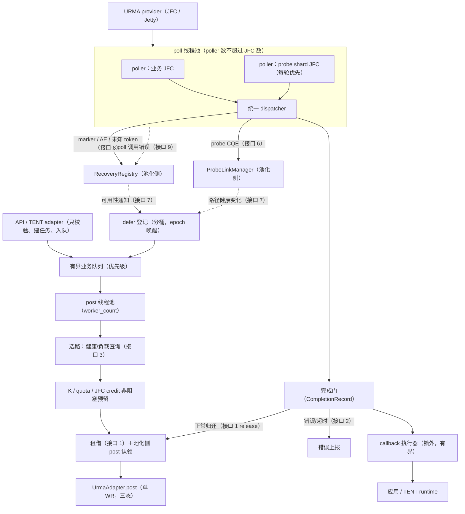
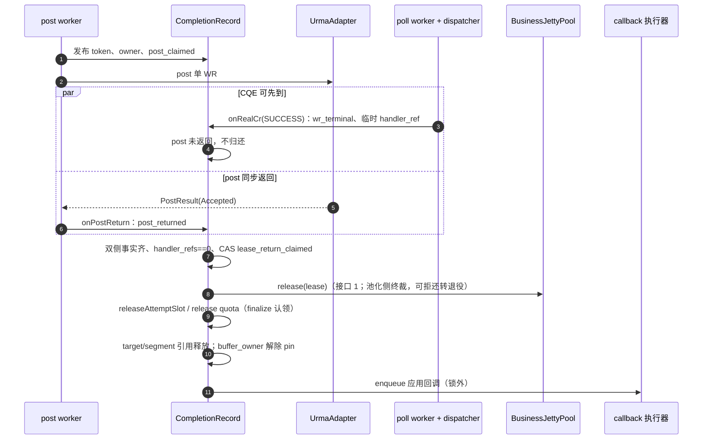

# TENT UB RM post/poll 线程池与完成路径详细设计

> 日期：2026-11-04（修订版）。配套文档：V3 详设《tent-ub-rm-jetty-pool-design》（main_learn，1103 整合版；经决议 13 核对与 main_learn 11-02 版为同一份）、池化详设《supercache_jetty_pool_current_and_target_rm_concise》（2026-11-03 整合版，池化侧文档，见 §2.4 版本偏差）。
> 代码基线：Mooncake v3 / 956af65e（mooncake-transfer-engine/tent），本文行号均对应该基线；UMDK 参考基线 09086da5（gitcode.com/openeuler/umdk，同级参考，非构建依赖；本地检出 .tmp-umdk/，09086da5 为其祖先，本文引用行号已逐条复核）。
> 状态：待实现设计，不表示当前代码已支持。本文仅覆盖 post/poll 线程池、K 准入、事件分类与分发、完成门与归还、超时扫描、callback 执行器和启停协议。
> **2026-11-04 修订说明**：对齐纪要《tent-ub-pool-alignment》（2026-11-04，13 项决议＋接口冻结）已全部并入本文 §2 / §7.2.1 / §10 / §12，原文件删除，本文为两侧对齐的唯一文档。本次评审修订要点：
> ①冻结接口由 6 个扩至 10 个（新增可用性通知、实体事件上报、context 故障上报、JFC 排他与 flush 协调），接口 1 增加 `tryClaimPost`——接口 7-10 与该扩展待池化侧确认后正式冻结；
> ②修复 defer 丢唤醒竞态与全局 epoch 惊群：改分桶 epoch＋"先读后判＋登记后复核"（§5.4）；
> ③submit 改为先查容量后 markQueued，消除被拒 Task 的状态滞留（§5.1）；
> ④事件分类改为 namespace/AE 先行，修复带 flush flag 的 probe 真实 CQE 漏进业务结算的缺口（§7.2）；
> ⑤明确错误/超时路径经 finalize 释放而非完成门（§1.4.2、§8）；
> ⑥补 owner 释放顺序（§7.4）、stopping 全量回流（§5.4、§9）、`business_queue_budget >= max_slices_per_task` 启动校验（§11）、十类完整枚举（§7.2）、TimeoutScan 有序结构（§8）。
> 不在本文范围：Jetty 池化与预算（池化详设 §5）、排空/退役/删除/补池（其 §7）、探测与健康状态机（其 §6）、RM adapter 迁移与 bootstrap v2（其 §4）、TENT/Store/staging 安全接入（决议 12，单独指派）。

## 1. 约束语义与设计边界

### 1.1 队列与提交约束

1. 业务队列有界（queue budget）。submit 按 Task 整体准入（all-or-nothing）：**先按可入队 slice 数查容量，容量足够才逐 slice markQueued 并入队**；容量不足时整 Task 返回背压错误，slice 状态不被触碰，不部分入队、不无界堆积、不静默丢弃。slice.h 状态机中 kQueued 无 unmark 路径（只能经 beginAttempt 或 requestCancellation 离开），若先标记后拒绝，被拒 Task 的 slice 将滞留 kQueued 且重试 submit 时 markQueued 全部失败（详见 §5.1 注）。
2. defer（延迟重排）不是失败：pool miss（借不到工位）、K 满、quota 满、credit 不足一律进 defer 登记；不 markFailed、不递增 retry_count、不记路径故障、不临时创建 Jetty、不触发模式回退（决议 6）。
3. defer 登记有界，parked（暂存等待）项计入 queue budget（queued＋parked 总量），不产生第二套无界集合。
4. 资源归还、补池、健康与代次变化**分桶**更新 availability epoch（可用性版本号）并唤醒对应谓词的 parked 调度（§5.4）；stopping 是无条件唤醒源，触发全量回流。禁止定时盲轮询（移除现 workers.cpp:450 的 50µs 盲等）。
5. submit 前 Task 必须 sealed（切片集合封闭）；`UbTask::seal` 只封闭集合，不构成 post 退出或 DMA 屏障。

### 1.2 post 约束

1. 每个 slice（切片）attempt（一次尝试）独立选路；先选路、后从所选 Context 的池租用（`tryAcquireOne`，接口 1），不按组、批次或 endpoint 汇聚；重试创建新 attempt。
2. 每 attempt 最多一次 native post（原生下发），输入恰好一条 WR（工作请求），`next=null`。
3. 准入顺序固定：target/Region 准备 → K → quota → JFC credit（随租借预留）→ lease（租约）→ **池化侧 post 认领（`tryClaimPost`，接口 1）** → native post；任一步失败逆序回滚已持有资源，不持部分资源阻塞等待（V3 §7.2）。record 的 `post_claimed` CAS 仅防本侧对同一 attempt 重复 post；"是否允许 post"的权威判定在池化侧 claim（§5.5）。
4. post 结果采用三态 acceptance（接受状态，接口 5）：`NotAccepted`（确定未接受）才回滚并允许重试；`Accepted`/`Unknown` 不重放；`Unknown` 交排空。真实 CQE 与"确定零接受"冲突时隔离该资源。
5. K（`task_max_inflight_attempts`）约束单个网络 UbTask 跨 Context 的并发 attempt；父请求 C 个 CROSS 子任务可达 C×K；K ≠ 池大小 ≠ staging（中转缓冲）窗口。
6. post worker 不执行 native create/delete/modify/flush，不持 lease 等待 RPC 或握手；缺失 target 由控制执行器异步补齐，该候选本次延后。

### 1.3 poll 与完成约束

1. 每个 JFC（完成队列）唯一正常 poller（收活线程），含池化侧预留的 probe shard（探测分片）；poller 数 = min(poller_count, JFC 数)。probe shard 在其所属 poller 的轮询序中排首位，控制完成优先于业务批量（§7.1）。
2. 事件先分类再分派：**token namespace（probe/业务/未知）与 AE 类型先行路由；业务 token 内部先 CR flag（完成回执标志位）后 status（状态码）**（UMDK 实机结论，§7.2、§7.2.1）。marker 不按 poll 条数扣 WR/JFC credit。
3. probe CQE（独立 token 编号区间）携带原始 CR 整体转发池化侧 ProbeLinkManager（接口 6），本侧不解释其健康语义（决议 10）；探测 Jetty ERROR 排空产生的带 flush flag 的 probe 真实 CQE 也走该转发，不进入业务结算（§7.2）。
4. 完成门是归还唯一判据：`post_returned && acceptance == Accepted && 唯一真实 SUCCESS CQE && 旧 handler 不再访问可复用状态 && 未见 fault/retire && pool OPEN && lease_return_claimed`。token 先于 native post 发布；post 返回与 CQE 任意先后，双入口推进同一完成门。本侧完成门判定是必要条件：**"未见 fault/retire && pool OPEN"的最终裁决在池化侧 `release()` 内同步完成**（AE/retire 是池化侧异步状态，本侧 record 的 fault_seen 看不到），release 可拒绝归还并转入退役，归还不得早于 FAULTED 转移（接口 1、§7.4）。
5. poll 热路径不调用应用 callback（回调）、不做同步 quiesce（静默排空）、不等待 provider；错误 CQE 后本侧只做三件事：按 token 结算本次业务、上报 `beginErrorOnce`（接口 2）、继续正常轮询（决议 5）。接口 2/7/8/9 的上报调用均为非阻塞入队（有界、合并），不得在 poll 线程同步等待池化侧。
6. JFC 的有限批次软件 flush（冲刷）提取是本侧向池化侧排空协调提供的服务（接口 10），返回记录经同一 dispatcher（分发器），维持 JFC 单消费者不变量。

### 1.4 超时约束

1. 超时＝首次错误（决议 9）：TimeoutScan（超时扫描）只标记 `timed_out`/`fault_seen` 并走 `beginErrorOnce` 统一上报；工位退役与排空由池化侧推进（其状态机补 LEASED→FAULTED 超时边），本侧不做同步 quiesce。
2. 超时不解除 buffer pin（内存钉住）、不重放：逻辑层以 TIMEOUT 结算、ExecutionOutcome（执行结果）＝Unknown；WR 硬件责任未结束前 K permit、quota、lease 引用不释放。**错误/超时路径不经正常完成门（fault_seen 已置位，完成门永不通过）：K/quota/target/segment/buffer 由 record finalize 一次性认领释放，lease 交池化侧退役处置（§8）**。
3. 同一 slice 的新 attempt 调度必须等旧 attempt 的 CompletionRecord（结算记录）安全终结，复用现有 attempt 一次性提交语义（slice.h 的 beginAttempt/tryCommitPost）。

### 1.5 职责边界

| 本侧不做 | 归属 |
| --- | --- |
| Jetty 创建/租借/归还执行、LIFO（后进先出）栈、预算 | 池化详设 §5 |
| modify ERROR、flush-done 状态机、DELETE_READY、删除/补池线程 | 池化详设 §7 |
| 探测调度、探测 WR 构造、健康状态机、campaign（体检轮次） | 池化详设 §6 |
| RM adapter 底层（三态 post、RemoteTarget）、bootstrap v2 | 池化详设 §4 |
| TENT/Store/staging 安全接入 | 决议 12（§2），单独指派 |

## 2. 分工边界与对齐决议（并入自纪要 2026-11-04）

本节为原《tent-ub-pool-alignment》纪要内容，是两侧开工与接口冻结的依据；接口签名与语义见 §10。

### 2.1 分工边界

| 归属 | 内容 |
| --- | --- |
| post/poll 线程池侧（本文档） | 有界业务队列；post 池（选路四条件＋分层评分、K/quota/JFC credit 非阻塞预留与逆序回滚、`tryAcquireOne` 单租、单 WR post、三态 acceptance 处理）；poll 池（每 JFC 唯一 poller、事件分类与分发（含 probe CQE 派发，接口 6）、完成门与归还、token 结算、超时扫描重构）；K 准入实现（`task_max_inflight_attempts`）；callback 执行器（归 post 侧，决议 11）；deferPending 不加 retry；观测（early_cqe / task_K_wait / unknown_token / poll_pause_us 等） |
| 池化侧（同事） | BusinessJettyPool（LIFO 空闲栈、租借、预算）；探测全包（ProbeLinkManager、probe_scheduler 直接 post 探测 WR（不经 post 池，决议 10）、peer campaign、健康状态机、探测 Jetty 资源）；排空/退役/删除/补池（modify ERROR → flush-done → 软件 flush → DELETE_READY → retire/refill 线程）；RM adapter 迁移（三态 post、RemoteTarget）；bootstrap v2；TargetRegistry；tombstone/事件屏障；设备 gate 与配置键 |
| 两侧咬合点 | ①租借/认领与归还（完成门 → release 入 LIFO）②错误上报（poll dispatcher → beginErrorOnce）③选路健康查询＋JFC 清单（含 probe shard 预留）④probe 完成派发（接口 6）⑤可用性通知与排空/JFC 协调（接口 7/10，本次修订新增） |

### 2.2 决议（13 项，2026-11-04 待确认项清零）

1. 探测子系统（campaign、调度、状态机、探测资源）由池化侧全包；post/poll 侧只保留两个钩子：选路时查健康、结算业务错误时上报。
2. 探测为业务错误触发、恢复即停（`stop_on_recovery=true` 固定）；campaign 按 V3 §13 快照该 peer 全部合法路径、每路径一个任务、首轮收敛后退出；不照搬 UMDK 的常驻周期探测。
3. 恢复门槛 = `recover_success_threshold` 固定 1 ＋ V3 全套门禁（当前 PathVersion、fault_epoch 匹配、target/context 未撤销、无更晚业务错误、外层门禁）；否掉"连续 N 次成功"简单版。
4. modify ERROR 可移交 control/recovery 执行器推进，poller 不阻塞、继续消费 CQE（对齐 V3 §9.3）。
5. 排空/删除/补池归池化侧；poll 线程在错误 CQE 后只做三件事：按 token 结算本次业务、上报、继续正常轮询。
6. Slice（切片）独立选路、单 attempt（一次尝试）单 WR、先选路后租用；pool miss（借不到）→ deferPending，不加 retry_count、不 markFailed、不记路径故障、不临时建 Jetty。
7. 链路数量按配置邻接动态计算（4 口→8、6 口→12），禁止硬编码；`probe_link_count = Σ degree(local_port)`。
8. "flush error down" 的准确名称是 `URMA_CR_WR_FLUSH_ERR_DONE`，代码与日志不得写错名。
9. 业务 WR 超时＝首次错误（决议 2026-11-04）：slice 超时触发该工位退役（LEASED→FAULTED）＋路径隔离＋触发探测，池化侧状态机与异常矩阵补此行；post 侧超时扫描只标记责任不明并走统一错误上报，不做同步 quiesce。
10. 探测包不经 post 池（决议 2026-11-04）：probe_scheduler 直接 post 探测 WR，post 侧不新增受限探测队列入口；probe 完成仍由 poll 线程按独立 token namespace（编号区间）派发给 ProbeLinkManager。本条是对 V3 §16.1"探测也交 post 池"的有意偏离，记录在案，避免后续误当缺陷回改。
11. 线程归属（决议 2026-11-04）：post/poll 线程循环体由 post 侧编写，UbContext 只做装配与资源；retire/refill/probe 线程归池化侧；callback 执行器随 post 侧。
12. P1-E 的 TENT/Store/staging 安全接入（proxy_manager.cpp / transfer_engine_impl.cpp / Store batch/free）单独指派，不计入两侧范围（决议 2026-11-04）。
13. V3 版本核对无误（决议 2026-11-04）：池化侧整合的 1103 版与 main_learn 11-02 版为同一份。

### 2.3 开放的次要项（不阻塞开工）

probe interval / backoff_max / peer_budget 默认数值（补配置表）；ST 实机环境排期（provider_event_drain_gate 依赖）。

### 2.4 配套文档版本偏差（注意）

池化详设《supercache_jetty_pool_current_and_target_rm_concise》为 2026-11-03 整合版，早于上述 11-04 决议：其 §1.3 仍写"poll 线程关闭 PostGate、调用 modifyJetty(ERROR)"（与决议 5 冲突），§5.1 状态机与 §11.1 异常矩阵尚未纳入决议 9 的"超时→FAULTED"行。**两侧文档冲突时以本文 §2 决议与 §10 接口为准；池化侧文档需按决议 4/5/9 同步更新后方可作为实现依据。**

## 3. 现状基线与差距

| # | 现状（基线 956af65e） | 目标设计 | 章节 |
| --- | --- | --- | --- |
| 1 | 优先级 deque 无界（workers.h:229） | 有界队列＋分桶 defer 登记＋availability epoch 唤醒 | §4、§5 |
| 2 | poller stride 绑定 JFC，数量 min(poller_count, JFC)（workers.cpp:374-377） | 保留绑定模型，纳入 probe shard 且每轮优先 | §7.1 |
| 3 | post 用 `endpoint->jetty(worker_index)` 选工位（workers.cpp:904） | 选路后 `tryAcquireOne` 租借＋池化侧 `tryClaimPost` 认领 | §5.5 |
| 4 | Inflight 仅 token/引用/超时位（workers.cpp:54-68） | CompletionRecord 13 字段＋完成门 | §7.3、§7.4 |
| 5 | post 二态，靠 posted_count 推断接受（urma_adapter.h:268） | PostResult 三态 acceptance | §6 |
| 6 | 无 K | task_max_inflight_attempts 准入 | §5.3 |
| 7 | 事件 7 类枚举，poller 线程直接回调应用（workers.cpp:1000-1032） | 十类分类＋callback 执行器 | §7.2、§7.5 |
| 8 | 超时同步 quiesce＋fence 后结算（workers.cpp:1035-1105） | 标记＋上报，退役排空归池化侧 | §8 |
| 9 | deferPending 50µs 盲等（workers.cpp:440-466） | 分桶 availability epoch 精准唤醒 | §5.4 |
| 10 | 健康被动：RailMonitor 错误窗口＋cooldown 暂停 | 选路查池化侧健康（接口 3）；EWMA 带宽样本保留本侧 | §5.2 |

## 4. 资源模型与线程职责

| 组件 | 唯一职责 |
| --- | --- |
| BoundedSubmitQueue | 优先级队列、容量账本（queued＋parked）、all-or-nothing 准入（先查后标记）、背压 |
| DeferRegistry | 分桶 parked slice、等待谓词（桶 epoch/stopping/cancel）、快照复核、脏桶回流 |
| UbTask K slot | 每任务跨 Context attempt 槽位计数，非阻塞获取/释放（slice.h） |
| PostWorker | 选路、准入、租借、池化侧 claim、单 WR post、onPostReturn 推进完成门 |
| PollWorker | 唯一 JFC 消费、批量 poll（probe shard 优先）、喂 dispatcher；有限批次 flush 提取服务；响应 JFC 暂停（接口 10） |
| Dispatcher | 事件分类（AE→namespace→flag/status）、token 路由、probe 派发、marker/AE/未知 token 上报 |
| CompletionGate | 每 record 的 8 项事实位、一次性认领、归还/退役判定与 owner 释放顺序（§7.4） |
| CallbackExecutor | 有界队列、锁外调用 slice/task 回调 |
| TimeoutScan | inflight 截止扫描（按 deadline 有序结构、按 poller 分区），标记＋上报（无 quiesce） |

锁与有界执行：

- queue/defer/registry 锁内只做短状态变更，不跨 adapter、RPC、callback 持有；锁顺序固定 DeferRegistry → queue，回流扫描持 defer 锁有界分批。
- CompletionRecord 以原子事实位＋一次性 CAS（比较交换）认领推进，无长临界区。
- 所有队列有界；等待均可被 cancel/stop 打断。
- availability epoch 按桶单调递增；仅 bump 对应桶并置回流脏位，多次 bump 合并为一次扫描，不做与谓词无关的无效唤醒。

线程数量：post 池 worker_count（默认 6）、poll 池 poller_count（默认 2，截断到 JFC 数）、callback 执行器首版 1 线程；本侧不新增其他常驻线程（删除/补池/探测/控制线程归池化侧；回流由被唤醒的 post worker 执行，§5.4）。

## 5. 提交、选路与准入

### 5.1 提交路径

~~~text
submit(task):
  校验 sealed、accepting
  需要容量 = task 可入队 slice 数（kInitial/kRetryPending 且未取消——只统计，不改状态）
  lock(queue): 总深度（queued＋parked） + 需要容量 <= queue_budget ?
    否 -> 解锁，返回 TooManyRequests（整 Task 背压；slice 状态未被触碰，
          调用方可安全整 Task 重试 submit）
    是 -> 逐 slice markQueued（失败者按取消/终结结算并跳过），
          全部入队，notify
cancel(task): requestCancellation + notify（保留现语义）
~~~

注：现实现（workers.cpp:291-309）先 markQueued 后入队；kQueued 在 slice.h 状态机（slice.h:216-227）中只能经 beginAttempt 或 requestCancellation 离开，无 unmark。若保留"先标记后查容量"的顺序，被拒 Task 的 slice 将滞留 kQueued、无人处理且重试 submit 时 markQueued 全部失败——故容量判定必须先于任何状态变更。

启动校验：`business_queue_budget >= max_slices_per_task`（不足则拒绝启用，§11）。否则 64 KiB × 65536 片（4 GiB）的整 Task 在 all-or-nothing 语义下永远无法一次性准入，大请求将稳定被背压。

### 5.2 候选与评分

候选路径必须同时满足（池化详设 §2.3，经接口 3 查询）：

~~~text
path.health ∈ {HEALTHY, ELIGIBLE_UNVERIFIED}
&& target.epoch == current_epoch
&& context.state == ACTIVE
&& node/port gate allows business
&& target/Region/profile valid
&& business_pool.hasIdle(path.context)
~~~

评分分层沿用 UbPathSelectionScore 结构（workers.h:53），口径修正：`endpoint_outstanding_*` 两项替换为接口 3 附带的 PathRegistry/ImportedTargetRegistry 聚合负载；EWMA（指数加权平均）带宽样本继续由本侧 RailMonitor 维护（recordSuccess/latency 采样保留，错误窗口与 pause 语义移交池化侧健康状态机）。分层顺序：可准入 → 拓扑等级 → 归一化在途 WR/字节 → target 压力 → 有效带宽 → retry_order/稳定设备 ID。

无空闲 Jetty 时按序尝试其他合格候选；全部不足 → defer（§5.4，pool idle 桶）。缺失 target 的候选本次跳过并由控制执行器异步补齐。

### 5.3 K 准入

~~~text
UbTask（slice.h）新增：
  inflight_attempts（原子计数，跨 Context 统一）
  tryAcquireAttemptSlot(): inflight < task_max_inflight_attempts 时 CAS+1，否则失败
  releaseAttemptSlot(): 两种时机——确定未接受；或 WR 终结且 post/handler 引用退出
~~~

- 获取失败 → defer（K 桶，资源不足语义，非失败）。
- K 释放与 native 预算分层：WR 安全结束即可还 K，不必等工位删除。
- 父请求 C 个 CROSS 子任务贡献 C×K 并发上限，仍受池与设备额度约束。

### 5.4 defer 与 availability epoch 唤醒

epoch 分桶：按首个失败准入步分桶（K 满 / quota·credit 满 / pool idle 空 / 路径不可用），各自单调递增；parked 项记录 (reason, wait_epoch)。**判定顺序固定为"先读桶 epoch、再判条件、登记后复核"**：

~~~text
准入评估（按序，每个条件先读其桶 epoch 再判定）：
  ep = bucket_epoch[K]；tryAcquireAttemptSlot() 失败
    -> 回滚已持资源，deferPending(pending, K, ep)
  （quota/credit/lease/路径资格同理，各持各自桶快照）

deferPending(pending, reason, wait_epoch):
  若 stopping 或 slice 已取消 -> requestCancellation
  否则在 DeferRegistry 临界区内（与回流互斥）：
    若 bucket_epoch[reason] != wait_epoch
      -> 判定期间该桶已变化，不入表，立即回流重试（防丢唤醒）
    否则记入 DeferRegistry[reason]，wait_epoch

onAvailabilityChange(reason):   // 本侧资源释放，或池化侧经接口 7 通知
  bucket_epoch[reason]++
  置回流脏位并 notify（多次 bump 合并为一次扫描；不在 poll 热路径内联全量回流）

回流（单次扫描消化全部脏桶，由被唤醒的 post worker 在取队列前执行）：
  stopping -> 全桶无条件回流；命中 stopping/cancel 谓词者 requestCancellation 结算
  否则仅回流脏桶中 wait_epoch < bucket_epoch[reason] 的项，
  按原优先级回队列并 notify
~~~

- **快照必须在判定前读取**：若 wait_epoch 取"登记时"的当前值，会吞掉"条件判定失败 → 登记入表"之间发生的 bump（唤醒扫描先跑、该项尚未入表），该 slice 将等到下一个无关事件才可能被唤醒——丢唤醒。复核（`bucket_epoch != wait_epoch` 则不入表）精确覆盖该窗口。
- **分桶避免惊群**：一次 K 释放只唤醒 K 桶，不惊动 pool-miss 桶；回流失败的 slice 以新快照重新 park，无忙等、无 retry 递增。全量唤醒仅发生在 stopping。
- parked 项计入 queue budget（§1.1.3）；回流在桶间/队列间保持锁顺序（§4）。

### 5.5 原子准入与逆序回滚

1. 准备已验证 endpoint、imported target 引用（经池化侧 registry）与 Region（沿用 buildRoute＋buffers 查找）。
2. 非阻塞依序预留：K slot → device/path quota（QuotaManager 既有 tryAcquireFirst）→ JFC credit（tryAcquireOne 内预留）。
3. `tryAcquireOne(path)` 成功得 JettyLease（绑定 AttemptKey＋LaneKey＋PathVersion）。
4. 发布 token 与全部 owner；随后调用接口 1 的 `tryClaimPost(lease)`：池化侧在其 PostGate ticket/close 的**同一同步域**内复核 stopping、PathVersion、fault_epoch、target/注册代次，原子返回 `Claimed` 或 `GateClosed(原因)`；`Claimed` 后本侧以 record CAS `post_claimed` 防双发，随即执行唯一 native post。
   - claim 必须落在池化侧：fault_epoch/PostGate 是池化侧状态，本侧 record 的 CAS 无法与 gate close 线性化；"close 不作废已认领 ticket、作废未认领 ticket"的语义由池化侧在同一临界区定义（对齐 V3 §7.2.5、池化详设 §5.2.3）。否则存在窗口：路径已被隔离（如同路径另一 WR 出错、fault_epoch++），本 attempt 仍向已隔离路径 post。
5. post 单 WR（§6）。
6. 任一步失败逆序回滚：撤销 post 认领 → 释放 lease → 释放 quota → 释放 K → 撤销已发布 token；全程不持部分资源等待。
   - `GateClosed` 同样逆序回滚；slice 记 defer（路径/池对应桶），不消耗 retry——关闭该 gate 的隔离/代次事件本身会 bump 对应桶并唤醒重试。

## 6. post 执行与三态 acceptance

~~~text
PostResult post(jetty, target, work_request)   // 接口 5
  status / acceptance: NotAccepted | Accepted | Unknown / posted_count ∈ {0,1}
~~~

| acceptance | 处理 |
| --- | --- |
| NotAccepted | 逆序回滚（§5.5）；slice 走 resolveBeforePost 失败路径——这是真实失败，retry 计数正常消耗（区别于 pool miss 的 defer） |
| Accepted | record.acceptance=Accepted；onPostReturn 置 post_returned；与 CQE 侧共同推进完成门 |
| Unknown | 不回滚、不重放、不释放 lease；上报 beginErrorOnce 交排空（工位退役）；record 保留至硬件责任终结 |

- token 在 native post 前发布进 registry；post 调用栈强持有 record（handler_refs＋1），返回即 `onPostReturn(record, result)`。
- WR 构造：operation、地址、token、target 引用、segment 引用；恰好一条，next=null。
- 旧 vector 版 post 接口在 pooled RM 下必须断言长度 1；不得以 posted_count 推断接受状态。

## 7. poll、事件分类与完成门

### 7.1 poller 绑定与循环

- 初始化经接口 4 取 JFC 清单（含 probe shard），stride 分配：poller i 负责 JFC[i], JFC[i+N], …。
- **probe shard 排其所属 poller 轮询序首位，每轮必先 poll**：控制完成（probe、marker）延迟上界＝一轮批量 poll，不受业务 JFC 满载挤压；业务 JFC 之间保持 stride 顺序。首版不设专职 probe poller（决议 10 下 probe WR 不经 post 池，但完成仍在本侧派发）；实机测得控制延迟超标再升级为专职。
- 循环：批量 poll（默认 64）→ 逐条喂 dispatcher → 每 1ms 一次 TimeoutScan（CAS 幂等，可优化为单扫描者）→ 无进展 sleep 20µs（保留现退避；JFCE 事件驱动列为后续优化）。
- poll 返回错误：经接口 9 按 context 故障上报池化侧（现 handleLocalDeviceFailure 入口，workers.cpp:381，改接池化侧），本侧不重建资源。
- poller 响应接口 10 的 JFC 暂停：每轮开始前检查本 poller 各 JFC 的 pause 标志，命中则跳过该 JFC 并确认已退出其临界区（记录 poll_pause_us），恢复后继续。

### 7.2 事件分类（判定顺序固定）

~~~text
onCompletion(cr):
  1. CR 类型为 AE
       -> 按实体经接口 8 上报池化侧并按 API ACK；不当业务 token
  2. token ∈ probe namespace
       -> 原始 CR 经接口 6 转发 ProbeLinkManager（PLM 自行按 flag/status
          语义解释；stale 只结算旧责任，不更新当前健康）
  3. token ∈ 业务 registry
       3a. cr.flag.bs.flush_err_done / suspend_done == 1
            -> 真实 WR（user_ctx 有效）-> 按 token 路由结算      [urma_types.h:1139-1140]
       3b. 未置位而 status == URMA_CR_WR_FLUSH_ERR_DONE / URMA_CR_WR_SUSPEND_DONE
            -> 实体 marker（user_ctx 无效）-> 经接口 8 按 JFC/实体类型/
               local_id 上报池化侧（ERROR 代次由池化侧按其 RecoveryRegistry
               归属）；不扣 WR credit                          [udma_u_jfc.c:756-763]
       3c. 其余 -> 按 status 结算：SUCCESS / 首次真实错误（含 WR_FLUSH_ERR）/ WR_UNHANDLED
  4. 未知 token
       -> unknown_token++ 记账并经接口 8 上报诊断（kind=unknown_token，
          携带 JFC/local_id 线索，供池化侧 tombstone/事件屏障归因）；
          不崩溃、不清除其他责任
~~~

判定顺序说明：

- **namespace/AE 先于 flag/status**：探测 Jetty ERROR 排空时，其 in-flight probe WR 的 CQE 带 flush_err_done flag（真实 WR、user_ctx 有效）；若先走业务 flag 分支，probe 真实 CQE 会漏进业务结算路径。probe token 一律整体转发接口 6，由 PLM 解释。
- **业务 token 内部先 flag 后 status**：status 枚举的同名值是硬件伪造假回执（urma_opcode.h:152-153），CR flag 位域的同名 bit 却标记真实 WR——不可凭名字清 token。

十类完整枚举（W2 验收依据；各类语义细节另见 V3 §10.1 与池化详设 §7.1，下表为其在本侧的执行展开）：

| # | 类别 | 判定特征 | 处置 |
| --- | --- | --- | --- |
| 1 | SUCCESS | 业务 token，无 marker flag/status | 完成门推进，EWMA 采样 |
| 2 | 首次真实错误（含 WR_FLUSH_ERR） | 业务 token，status 错误类 | token 结算＋beginErrorOnce（接口 2）＋fault 隔离 |
| 3 | CR flag 陷阱真实 WR | flag.bs.flush_err_done/suspend_done 置位 | 按真实 token 结算，不清 token |
| 4 | 实体 flush-done marker | 无 flag，status=FLUSH_ERR_DONE，user_ctx 无效 | 接口 8 上报，不扣 WR/JFC credit |
| 5 | 实体 suspend-done marker | 无 flag，status=SUSPEND_DONE，user_ctx 无效 | 接口 8 上报 |
| 6 | WR_UNHANDLED（软件 flush 取出） | urma_flush_jetty 提取，user_ctx 有效（udma_u_jfs.c:1171/1208） | 经 dispatcher 按真实 token 结算，不计成功 |
| 7 | AE | CR 类型为异步事件 | 接口 8 实体上报＋API ACK |
| 8 | probe CQE | token ∈ probe namespace | 接口 6 转发 PLM（含带 flag 的真实 CQE） |
| 9 | 未知/迟到 token | 不在业务 registry | 记账＋接口 8 诊断上报 |
| 10 | poll 调用错误 | poll 返回非 OK | 接口 9 context 故障上报 |

#### 7.2.1 UMDK 实机核验依据（并入自纪要 §4，基线 09086da5，本地 .tmp-umdk/）

| 事实 | 源码出处 | 影响 |
| --- | --- | --- |
| status 枚举 `URMA_CR_WR_FLUSH_ERR_DONE / SUSPEND_DONE` 是硬件伪造的假 CQE（user_ctx 无效）；CR flag 位域里同名 bit 却是真实 WR（user_ctx 有效） | urma_opcode.h:152-153；urma_types.h:1139-1140 | 业务 token 分类必须先看 flag 位再看 status，不能凭名字清 token |
| send CQE 的 fd 位置 1 → status 改写为 FLUSH_ERR_DONE、置 queue->flush_flag，且不消费 wrid、不推进 ci | udma_u_jfc.c:756-763 | marker 不占 WR/JFC credit 的实机机制 |
| `flush_jetty` 必须 flush_flag 已置位才取得出；取出记录 status=URMA_CR_WR_UNHANDLED 但 user_ctx 有效 | udma_u_jetty.c:628；udma_u_jfs.c:1171,1208 | 排空两步铁律：先 poll 到 flush-done，再软件 flush；UNHANDLED 走统一 dispatcher 结算、不计成功 |
| delete 失败分支仍把工位从对象表移除 | udma_u_jetty.c:379-380 | "API 返回失败 ≠ 句柄完好"；三分类（RETAINED/CONSUMED/UNKNOWN）必须处理；迟到 CQE 落 "jetty destroyed" 分支属正常 |
| `clean_jfc` 与 poll 用同一把 CQ 自旋锁摘除/压缩 CQE | udma_u_jfc.c:1024-1079；:857 | poller↔删除线程排他协调（接口 10）的底层依据；上层锁不得与该锁嵌套 |
| 探测 WR：URMA_OPC_WRITE、complete_enable=1、next=null、1 字节 payload，注册区整页 | bondp_dp_health.c:29-36,431-444 | payload=1 ≠ 注册长度 1（ummu_grant 要求页对齐） |
| UMDK 为常驻周期探测（默认 1000ms，任务自我重排） | bondp_dp_health.h:24；bondp_dp_health.c:515-530 | 只参考 WR/邻接/事件原语，不照搬启动时机与同步重建 |

### 7.3 CompletionRecord（接口 5，两侧共用）

~~~text
CompletionRecord:
  token, attempt_key, path_version, jetty_generation, target_epoch
  post_claimed, post_returned, acceptance, wr_terminal
  handler_refs, fault_seen, finalize_claimed, lease_return_claimed
  jetty_lease, target_ref, segment_refs, quota_reservation, buffer_owner
~~~

- CompletionToken 进程内唯一，不复用对象地址；probe 与业务 token 分段编号。
- finalize 与 lease_return 均一次性 CAS 认领；重复 CQE、迟到 marker 只结算既有责任。
- owner 字段（lease/target/segment/quota/buffer）的释放顺序见 §7.4。

### 7.4 完成门与双入口

- 正常归还条件见 §1.3.4（verbatim 执行）。本侧判定为必要条件；**最终裁决在池化侧 release()**：release 在其同步域内复核成员 FAULTED/retire 状态，可拒绝归还转退役——归还不得早于 FAULTED 转移（V3 §8、池化详设 §5.2）。
- owner 释放顺序（正常路径）：`release(lease)`（接口 1，池化侧裁决）→ releaseAttemptSlot / release quota（finalize 一次性认领）→ target_ref/segment_refs 引用释放 → buffer_owner/pin 解除（以 WR 终结且 handler 退出为准，先于 callback 通知；READ 目的缓冲此刻起对应用可见）→ callback 入队。staging 槽位等复合 owner 的安全完成语义按决议 12 单独指派项细化，本文只固定顺序与归属。
- 首次真实错误（token 结算后）：fault_seen 置位 → 上报 `beginErrorOnce(LaneKey, jetty_generation, error_epoch, path_identity)` → lease 不归还，交池化侧退役；K/quota/target/segment/buffer 由 finalize 按 §1.4.2 释放。一次性认领保证不重复上报。
- WR_UNHANDLED（软件 flush 取出，user_ctx 有效，udma_u_jfs.c:1171/1208）：按真实 token 结算，不计成功。

### 7.5 callback 执行器

- 有界队列；满时背压并告警（完成事实已在 record 终结，仅通知延后，不丢失）。
- 锁外执行 slice resolveAttempt / task 推进，不阻塞 poller；shutdown 时排空后退出。

### 7.6 软件 flush 提取服务

- 池化侧排空协调经接口 10 请求本服务：`requestFlushExtraction(lane_key, error_epoch)`；poller（或持消费 lease 的授权任务）对该 lane 调 urma_flush_jetty，有界批次（首版 16/批）直至取空，结果经 dispatcher 按真实 token 以 WR_UNHANDLED 结算（十类之 6）。
- **取空后本侧经接口 10 回执 `onFlushDrained(lane_key, error_epoch, count)`**——池化侧以该回执作为其 DELETE_READY 条件"必要软件 flush 已取空并统一分发"（其 §7.1.7）的证据；没有该回执，池化侧无法判定排空收敛。
- 提取前提：该 lane 已观测 flush-done marker（flush_flag 机制，udma_u_jetty.c:628——未置位时 flush_jetty 返回 0，取不出任何记录）；空 poll 不是屏障。
- 与删除线程的 JFC 排他由接口 10 的 `requestJfcPause`/`resumeJfcPoll` 协调（底层依据：clean_jfc 与 poll 共用 CQ 自旋锁，§7.2.1）；本侧在协调窗口暂停对应 JFC 轮询并记录 poll_pause_us。

## 8. 超时扫描（TimeoutScan）

- 扫描节奏沿用每 poller 1ms（workers.cpp:404-409 保留）；**扫描数据结构改为按 deadline 的有序集合（最小堆/时间轮）**，替代现 inflight_ 全表线性扫（workers.cpp:1042 对 unordered_map 全扫；queue budget 放大到数万 slice 后，2 poller × 每毫秒全扫代价不可接受）。扫描集合按 poller 分区（record 归属其 JFC 的 poller），两 poller 不重复扫同一集合。
- 命中处理（替换 workers.cpp:1035-1105 的同步 quiesce 段）：
  1. `timed_out` 一次性 CAS 置位；
  2. `fault_seen` 置位，上报 `beginErrorOnce`（超时＝首次错误，决议 9）；
  3. 逻辑结算 TIMEOUT、ExecutionOutcome=Unknown：默认不自动重试，重试决策上移并遵循 Unknown WRITE 不重放、READ 目的内存保护（V3 §17.1）；
  4. record 保留至硬件责任终结（真实 CQE 或 flush 证据）；**届时 K/quota/target/segment/buffer 由 record finalize 一次性认领释放（错误/超时路径不经正常完成门，见 §1.4.2）；lease 已交池化侧退役处置**。
- 自然 CQE 迟到到达已超时 record：只终结硬件责任，不二次结算逻辑结果（finalize 一次性）。
- WaitExpired 不解除 buffer pin。

## 9. 启动与关闭

启动（依赖就绪后，对齐池化详设 §8.1 尾段）：

~~~text
接口 4 JFC 清单就绪 -> 构建 poller 绑定 -> poll 池启动
-> callback 执行器启动 -> post 池启动（空载）-> submit 开放
~~~

posting 线程不得首次 createJetty（池化侧预热完成后 workers.start）。

关闭（对齐 V3 图八与池化详设 §8.3 中本侧部分）：

~~~text
stop 新 submit
-> 队列与 defer 中 slice requestCancellation；stopping 触发全量回流（§5.4），回流命中谓词者结算
-> join post 池
-> 保持 poll：消费已接受 WR 的 CQE、marker 与排空证据
-> 配合池化侧 JFC 协调窗口（接口 10 暂停/恢复轮询，记录 poll_pause_us）
-> 事件责任结束（业务 registry 空，或责任经接口 8/10 移交池化侧并登记）
-> 排空 callback 队列，停 callback 执行器
-> 停 poller
~~~

- 停止可返回 Draining/Unproven：未证明责任的 record 连同 owner 经接口移交池化侧存活回收路径，不丢失；移交 record 的逻辑结果随 shutdown 返回值（Draining/Unproven）向调用方报告，不静默吞掉。
- 重复 stop 幂等；stopping 之后不得认领新 post（池化侧 claim 与本侧 gate 复核双重拦截）。

## 10. 与池化侧的冻结接口

接口 1-6 为 2026-11-04 纪要已冻结集合（原纪要 §3，已并入本文）；**接口 7-10 及接口 1 的 `tryClaimPost` 为本次修订新增，待池化侧确认后正式冻结**——原 6 接口均为"本侧调用池化侧/联合定义"，缺少池化侧→本侧的运行期通知与排空协调通道，本文 §5.4/§7.1/§7.2/§7.6 的职责无承载接口。

| # | 接口 | 签名草案 | 语义要点 | 实现 / 调用 |
| --- | --- | --- | --- | --- |
| 1 | 工位租借与认领 | `tryAcquireOne(path) → JettyLease \| ResourceUnavailable`；`tryClaimPost(lease) → Claimed \| GateClosed(原因)`；`release(lease)` | 单租不批量；lease 绑定 AttemptKey＋LaneKey＋PathVersion；幂等释放；归还 push_front 入 LIFO。**tryClaimPost（新增）**在 PostGate ticket/close 同一同步域内复核 stopping/PathVersion/fault_epoch/代次，防向已隔离路径 post（§5.5）。**release 是"未见 fault/retire && pool OPEN"的最终裁决点**，可拒绝归还转退役 | 池化侧实现 / post 侧调用 |
| 2 | 错误上报 | `beginErrorOnce(LaneKey, jetty_generation, error_epoch, path_identity)` | 一次性认领；modify 在 poller 还是 control 执行器执行由池化侧定（决议 4）；非阻塞、有界队列、重复合并，不阻塞 poll 热路径 | 池化侧实现 / poll dispatcher 调用 |
| 3 | 选路健康查询 | `snapshotEligible(peer, policy)` 一个接口拿齐 | health ∈ {HEALTHY, ELIGIBLE_UNVERIFIED} && target.epoch 有效 && context ACTIVE && hasIdle；附分层负载数据 | 池化侧实现 / post 侧调用 |
| 4 | JFC 清单 | 初始化时提供 JFC 列表（含 probe 预留 shard） | post 侧据此做 poller↔JFC 唯一绑定，poller 数 ≤ JFC 数 | 池化侧提供 / post 侧消费 |
| 5 | 共用记录结构 | `CompletionRecord`（13 字段，含 8 个完成门状态位）＋ `PostResult{status, acceptance: NotAccepted/Accepted/Unknown, posted_count}` | 两边共用同一结构定义，不各写一套；owner 字段释放顺序按 §7.4 | 联合定义 |
| 6 | probe 完成派发 | `onProbeCompletion(probe_token, CR)` | poll dispatcher 识别独立 token namespace 的 probe CQE（含带 flush flag 的真实 CQE），整体转发 ProbeLinkManager 更新健康；stale（过期代次）结果只结算旧责任，不更新当前健康 | 池化侧实现入口 / poll 侧调用 |
| 7 | 可用性通知（新增） | `onPoolAvailabilityChange(kind: refill_completed \| path_health_changed \| generation_changed)` | 池化侧补池完成、路径恢复、代次变化时通知本侧 bump 对应桶 epoch 并唤醒 parked 调度（§5.4）；非阻塞 | 本侧实现 / 池化侧调用 |
| 8 | 实体事件上报（新增） | `onEntityEvent(jfc_key, entity_type, local_id, kind: marker_flush_done \| marker_suspend_done \| async_event \| unknown_token, evidence)` | 实体 marker、AE、未知/迟到 token 诊断的统一上报入口（§7.2 步骤 1/3b/4）；ERROR 代次由池化侧按其 RecoveryRegistry 归属；供 tombstone/事件屏障归因；非阻塞、有界、按实体合并 | 池化侧实现 / poll dispatcher 调用 |
| 9 | context 故障上报（新增） | `onContextFailure(context_key, reason)` | poll 调用返回错误等 context 级故障（现 handleLocalDeviceFailure 入口改接此处）；本侧不重建资源 | 池化侧实现 / poll 侧调用 |
| 10 | JFC 排他与 flush 协调（新增） | `requestJfcPause(jfc_key)`（登记暂停＋完成通知）；`resumeJfcPoll(jfc_key)`；`requestFlushExtraction(lane_key, error_epoch)`；`onFlushDrained(lane_key, error_epoch, count)` | 删除线程取 JFC 消费/删除排他权：本侧 poller 跳过该 JFC 并确认退出临界区（记录 poll_pause_us），删除完成后恢复；flush 提取服务请求与取空回执（§7.6，取空回执是池化侧 DELETE_READY 的证据）。底层依据：clean_jfc 与 poll 共用 CQ 自旋锁（§7.2.1） | 暂停/恢复/请求：本侧实现、池化侧调用；回执：池化侧实现入口、本侧调用 |

注：接口 7-10 均要求非阻塞、有界队列、可合并；任何一侧不得在冻结接口上同步等待对端。

## 11. 配置项（前缀 transports/ub/）

| 键 | 默认 | 语义 |
| --- | --- | --- |
| worker_count | 6 | post 池线程数（沿用） |
| poller_count | 2 | poll 池线程数，截断到 JFC 数（沿用） |
| task_max_inflight_attempts | 待定（建议 4） | K：单网络 UbTask 跨 Context 并发 attempt 上限（已登记于池化详设 §9.1） |
| business_queue_budget | 待定；**必须 ≥ max_slices_per_task（启动校验拒绝）**，否则 64 KiB×65536 片（4 GiB）整 Task 永远无法一次性准入（§5.1） | 业务队列＋defer 登记总容量（queued＋parked） |
| callback_queue_budget | 待定 | callback 执行器队列容量 |
| slice_size / max_slices_per_task / slice_timeout_ms / max_retries | 既有 | 语义不变；slice_timeout_ms 现仅驱动 TimeoutScan 标记，不再驱动 quiesce |

注：business_queue_budget / callback_queue_budget 为本侧新增键，需同步登记进池化详设 §9.1 配置表。

## 12. 实施切分

总体顺序（并入自纪要 §6）：阶段零（接口冻结，即 §10，接口 7-10 待池化侧确认）→ P0-A/B/C（池化侧：RM mode、adapter、bootstrap）→ **P0-D（共同起点：单 attempt 单 WR、K/有序 gate、worker/endpoint 解耦——post 侧首个里程碑，fake adapter 单测先行，不被池阻塞）** → P1-A（池＋完成门）→ P1-B（错误链）→ P1-C（retire/refill）→ P1-D（campaign/probe）→ P1-E（shutdown/接入）→ P2（清理 RC）。

| 阶段 | 内容 | 验收要点 |
| --- | --- | --- |
| W0 骨架 | CompletionRecord、完成门双入口、dispatcher 骨架；fake adapter＋时钟/线程交错单测 | early CQE / post 返回 / cancel / 重复完成只结算一次 |
| W1 post | 选路四条件接入接口 3、K slot、逆序回滚（含 GateClosed 路径）、三态 acceptance | 回滚完整性（lease/quota/K/token 全释放）；pool miss 与 GateClosed 均不加 retry |
| W2 poll | 十类分类、probe 派发、marker/AE/未知 token 上报（接口 6/8/9）、callback 执行器 | flag 陷阱用例；**probe 带 flag 真实 CQE 转发不漏**；unknown token 用例；marker 不重复上报 |
| W3 超时 | TimeoutScan 重构（deadline 有序结构＋按 poller 分区），替换同步 quiesce | 超时→上报→record 保留时序；迟到 CQE 不二次结算 |
| W4 关闭 | stop 序列（含 stopping 全量回流）、Draining/Unproven 移交、接口 7/10 咬合 | shutdown 与 post/delete/refill 交错；parked 项在 stopping 后全部结算 |

每阶段先过注入 adapter、时钟与线程交错单测；实机验证依赖池化侧阶段零 provider 门槛（mock 不能证明 DMA fence）。

## 13. 异常矩阵与验收

| 场景 | 必须证明 |
| --- | --- |
| queue 满 | 整 Task 背压返回；不部分入队、不丢已入队项；**slice 状态未被触碰，重试 submit 可行** |
| K 满 / quota 满 / credit 不足 | defer；retry 不变；对应桶 epoch 唤醒后恢复 |
| pool miss | 下一候选 → 全部 defer；不 markFailed、不记路径故障 |
| NotAccepted post error | 逆序回滚完整；retry 计数正常消耗 |
| NotAccepted × 迟到真实 CQE 冲突 | 冲突隔离该资源，不按后到结果覆盖前者（§1.2.4） |
| Unknown acceptance | 不重放、不释放 lease；上报排空 |
| early CQE / post 返回 / cancel 交错 | 完成门只结算一次；实际 owner 不提前释放 |
| 首次真实错误 | 结算＋beginErrorOnce 一次性；lease 不归还、交退役 |
| marker 早到 / 重复 / 丢失 | 记账正确；不解引用无效 user_ctx；不重复上报 |
| CR flag 陷阱（flag 位 vs status 同名） | 业务 token 先 flag 后 status；真实 WR 不丢 token |
| **probe 带 flush flag 的真实 CQE** | namespace 先行，经接口 6 转发，不进业务结算 |
| WR_UNHANDLED | 经 dispatcher 结算，不计成功 |
| probe CQE | 转发接口 6；stale 只结算旧责任 |
| 未知 token | 记账不崩＋接口 8 诊断；不影响其他责任 |
| 超时 | 标记＋上报；record/K/quota 保留至责任终结；不自动重试、不解除 pin |
| callback 队列满 | 背压告警；完成事实不丢 |
| shutdown 交错 | stopping 后不认领新 post；未证明责任可移交且不丢失；stopping 后 parked 全部结算 |
| poll 调用错误 | 接口 9 上报；本侧不重建资源；不影响其他 JFC 轮询 |
| gate 复核 GateClosed | 逆序回滚完整；slice defer 不计 retry；对应桶 epoch 唤醒后重试 |
| defer 丢唤醒防御 | "判定失败→登记"之间发生 bump 不丢：快照复核用例（§5.4） |
| epoch 分桶 | K 释放不惊动 pool-miss 桶；回流重 park 有界 |

## 14. 观测指标与源码索引

本侧指标（对齐池化详设 §12.1 并补充）：

~~~text
early_cqe / cqe_before_post_return
task_K_wait / k_wait_count
defer_pending / defer_epoch_wakeup
defer_reflow_repark（回流后再次 park 比例——惊群与丢唤醒的观测手段）
defer_bucket_snapshot_retry（复核发现桶已前进、不入表直接重试的次数）
unknown_token / marker_by_category / probe_dispatched
begin_error_once_reported / timeout_marked
callback_queue_depth / callback_overflow
poll_pause_us / queue_depth
completion_gate_one_shot_violations（恒 0，违例即缺陷）
~~~

日志带 token / jetty_generation / error_epoch / path_version；每 WR 热路径不同步打印。

源码索引（本地路径以 mooncake-transfer-engine/tent/ 为根）：

| 文件 | 角色 |
| --- | --- |
| src/transport/ub/workers.cpp、include/tent/transport/ub/workers.h | post/poll 池、dispatcher、完成门、超时——主要改造对象 |
| include/tent/transport/ub/slice.h | UbTask K slot；attempt 一次性提交语义沿用 |
| include/tent/transport/ub/urma_adapter.h | PostResult/Completion 扩展（与池化侧 P0-B 联合） |
| include/tent/transport/ub/quota.h | 既有 quota 非阻塞预留沿用 |
| include/tent/transport/ub/rail_monitor.h | EWMA 带宽样本保留；错误窗口/pause 语义移交池化侧 |
| include/tent/transport/ub/params.h | 新增配置键 |
| UMDK 09086da5 | 事件分类与 flush 语义实机依据（§7.2.1；urma_opcode.h、urma_types.h、udma_u_jfc.c、udma_u_jetty.c、udma_u_jfs.c；本地检出 .tmp-umdk/，09086da5 为其祖先） |

V3 引用统一指 main_learn 分支《tent-ub-rm-jetty-pool-design》（决议 13 已核对与 1103 整合版同一份），无需另找 1103 快照。
